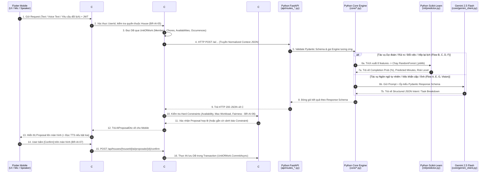

# KẾ HOẠCH TỔNG THỂ (MASTER PLAN): TRIỂN KHAI TOÀN BỘ HỆ THỐNG AI HOUSEKEEPER
## Dịch Vụ Quản Gia Trí Tuệ Nhân Tạo (Python FastAPI + Scikit-Learn ML + Gemini 2.5 Flash + Mobile On-Device Voice)

---

## 0. Tóm Tắt Nguyên Tắc Kiến Trúc & Tuân Thủ Business Rules (`BR-AI-01` → `BR-AI-15`)

Theo đúng SRS (Mục 36–48) và Business Rules (Mục 26–27), hệ thống AI Housekeeper được triển khai toàn diện nhưng tuân thủ nghiêm ngặt ranh giới kiến trúc Clean Architecture của Chore Wars:
1. **AI Is Decision Support (`BR-AI-01`, `BR-AI-07`)**: AI chỉ phân tích, dự đoán (Prediction) và đề xuất (Proposal). AI **tuyệt đối không** ghi trực tiếp xuống Database nghiệp vụ của C# và **không** tự ý đổi lịch đang `ACTIVE` hay cộng/trừ Karma nếu chưa qua bước **User Confirm** và **C# Core Engine Validation**.
2. **Separation of Concerns (`BR-AI-03`)**:
   - **Flutter Mobile**: Thu thập giọng nói (On-device STT), phát giọng đọc (On-device TTS), chụp ảnh bằng chứng, hiển thị AI Proposal / Zalo-style Action Card để các thành viên bấm Confirm/Reject.
   - **ASP.NET Core Backend (C#)**: Xác thực JWT, kiểm tra quyền thành viên trong House (`BR-AI-05`), trích xuất dữ liệu chuẩn từ PostgreSQL gửi sang Python, nhận kết quả từ Python và chạy qua **Fairness & Hard Constraint Engine** (`ChoreAllocationService`) trước khi lưu.
   - **Python AI Service (`ai-service/`)**: Đóng vai trò bộ não tính toán độc lập (Data Processing, Feature Engineering, **Huấn luyện & Dự đoán bằng Custom ML Model**, và gọi **Gemini 2.5 Flash** cho các tác vụ ngôn ngữ tự nhiên / thị giác).
3. **Graceful Fallback (`BR-AI-02`)**: Nếu `ai-service` hoặc Gemini API tắt/timeout, C# Backend tự động bắt lỗi qua cơ chế Timeout/Fallback và quay về thuật toán phân bổ công bằng thuần C# (`ChoreAllocationService`), đảm bảo app không bao giờ sập.

---

## 1. Tại Sao Dùng Python & Cách Tổ Chức Công Nghệ (Phần 1)

Mặc dù Backend chính viết bằng **C# (.NET 10)** rất mạnh về xử lý giao dịch (Transaction), phân quyền và bất đồng bộ, chúng ta tách riêng một microservice **Python 3.11 (`ai-service`)** vì:
- **Hệ sinh thái Machine Learning số 1**: Thư viện `scikit-learn`, `pandas`, `numpy`, `joblib` trong Python giúp gom dữ liệu lịch sử làm việc nhà, biến đổi đặc trưng (Feature Engineering) và huấn luyện mô hình dự đoán chỉ trong vài chục dòng code.
- **Chuẩn hóa dữ liệu nghiêm ngặt với `FastAPI` + `Pydantic`**: Đảm bảo 100% đầu vào/đầu ra giữa C# và Python tuân thủ JSON Schema (`BR-AI-04`), không bao giờ trả về văn bản tự do làm sập C# Backend.
- **Xử lý bất đồng bộ với Kafka (`confluent-kafka`)**: Lắng nghe các sự kiện (`chore.completed`, `chore.overdue`, `bounty.created`, `bounty.expired`, `season.ended`) từ C# bắn sang để âm thầm học thói quen của từng thành viên và tự động huấn luyện lại (re-train) mô hình.

### Bộ thư viện Python sử dụng (`requirements.txt`):
| Thư viện | Vai trò trong dự án |
| :--- | :--- |
| `fastapi` & `uvicorn` | Tạo REST API Server tốc độ cao tại cổng `8085` để C# Backend gọi sang. |
| `pydantic` & `pydantic-settings` | Kiểm tra kiểu dữ liệu JSON nghiêm ngặt (chặn dữ liệu rác từ LLM). |
| `scikit-learn`, `numpy`, `pandas`, `joblib` | **Trái tim ML**: Xử lý bảng dữ liệu, train model dự đoán xác suất trễ việc & thời gian làm việc, lưu model ra file `.joblib`. |
| `google-genai` | SDK chính thức gọi **Gemini 2.5 Flash** (xử lý ngôn ngữ tự nhiên tiếng Việt & chấm điểm ảnh chụp bằng chứng). |
| `confluent-kafka` | Nhận sự kiện thời gian thực từ C# Backend để cập nhật điểm thói quen (Habit Profile). |
| `pytest`, `pytest-asyncio`, `httpx` | Bộ công cụ chạy kiểm thử tự động toàn bộ thuật toán AI & API. |

---

## 2. Lựa Chọn Model Nào Cho Hệ Thống Mobile? (Phần 4)

Vì ứng dụng đích là **Flutter Mobile**, nếu nhét một mô hình AI nặng hàng chục GB vào điện thoại thì máy sẽ nóng ran, tốn pin và dung lượng cài đặt (APK) lên tới hàng GB. Ngược lại, nếu mọi thứ đều gọi lên LLM đám mây (như GPT-4/Gemini Pro) thì vừa chậm (mất 3–5 giây mới phản hồi trên di động), vừa tốn chi phí, vừa vi phạm nguyên tắc của SRS (*"Gemini chỉ gọi khi cần hiểu ngôn ngữ tự nhiên"*).

Do đó, giải pháp chuẩn xác nhất cho kiến trúc Mobile của dự án là **Mô Hình Lai 3 Tầng (3-Tier Hybrid AI Architecture)**:

```mermaid
graph LR
    subgraph Tier1 ["Tầng 1: Trên Điện Thoại (On-Device Mobile)"]
        STT["Speech-to-Text Native\n(Nhận diện giọng nói 0ms)"]
        TTS["Text-to-Speech Native\n(Đọc phản hồi Quản gia)"]
    end

    subgraph Tier2 ["Tầng 2: Tự Train Trên Server Python (Scikit-Learn Tabular ML)"]
        RF_Clf["RandomForestClassifier\n(Dự đoán % Hoàn thành & Rủi ro trễ)"]
        Ridge_Reg["RandomForestRegressor\n(Dự đoán Số phút làm việc thực tế)"]
        Rule_Evo["Heuristic + Habit Matrix\n(Tối ưu đổi việc & Tiến hóa Mùa giải)"]
    end

    subgraph Tier3 ["Tầng 3: Cloud LLM & Vision (Gemini 2.5 Flash API)"]
        NLU["Gemini Structured Output\n(Bóc tách lịch bận, tạo việc, chia việc 30p)"]
        Vision["Gemini Vision\n(Kiểm tra ảnh chụp rửa bát/đổ rác)"]
    end

    Tier1 -->|Gửi Text đã nhận diện| CSharp["C# Backend"]
    CSharp -->|Gọi dự đoán số liệu (<15ms)| Tier2
    CSharp -->|Gọi hiểu tiếng Việt / Ảnh (<800ms)| Tier3
```

### Chi tiết từng Model được chọn và lý do:

1. **Tầng 1 — Trên thiết bị Mobile Flutter (Xử lý Giọng nói - `BR-AI-15`, Flow 37 & 44)**:
   - **Model sử dụng**: Engine nhận diện giọng nói & đọc văn bản tích hợp sẵn trong hệ điều hành Android/iOS thông qua package `speech_to_text` và `flutter_tts`.
   - **Tại sao chọn cho Mobile?**: Không làm tăng dung lượng app thêm 1 MB nào, phản hồi tức thì trên màn hình để người dùng **kiểm tra lại văn bản trước khi bấm gửi** (đúng luật `BR-AI-15`: phải xem lại nội dung voice trước khi thực thi).

2. **Tầng 2 — Model Học Máy Tự Train trên Python Server (`scikit-learn`) (Phục vụ Flow B, C, D, F)**:
   - **Bài toán 1 (Phân loại - Classification)**: Dự đoán thành viên $U$ giao việc $C$ vào thứ $D$ có khả năng hoàn thành đúng hạn là bao nhiêu % (`completion_probability`: $0.0 \rightarrow 1.0$) và mức độ rủi ro (`risk_level`: `LOW`, `MEDIUM`, `HIGH`).
     - **Model chọn**: **`RandomForestClassifier`** (Rừng ngẫu nhiên) trong `scikit-learn`.
     - **Lý do**: Dữ liệu của Chore Wars là **dữ liệu dạng bảng (Tabular Data)** gồm: độ khó công việc, số phút ước tính, ngày trong tuần, tỷ lệ trễ hạn lịch sử của user, số lần đăng bounty. Với dữ liệu dạng bảng quy mô vừa và nhỏ (vài trăm đến vài chục nghìn dòng), `RandomForestClassifier` chạy nhanh hơn Deep Learning gấp 100 lần (chỉ tốn **< 5 mili-giây** mỗi lần dự đoán), file model sau khi train nặng chưa tới **500 KB**, và không cần GPU!
   - **Bài toán 2 (Hồi quy - Regression)**: Dự đoán thành viên $U$ mất thực tế bao nhiêu phút để làm xong việc $C$ (`predicted_duration_minutes`).
     - **Model chọn**: **`RandomForestRegressor`** trong `scikit-learn`.

3. **Tầng 3 — Mô hình Ngôn ngữ & Thị giác cho các tác vụ hiểu tiếng Việt / Ảnh (Phục vụ Flow A, E, G & Vision)**:
   - **Model chọn**: **`gemini-2.5-flash`** (thông qua thư viện `google-genai`) kết hợp tính năng ép kiểu **`response_schema` (Structured JSON Output)**.
   - **Tại sao chọn `gemini-2.5-flash` thay vì model Pro?**: Trên ứng dụng di động, người dùng không thể đợi 10 giây xoay vòng. `gemini-2.5-flash` là dòng model tối ưu tốc độ (Low Latency ~0.6s – 1.2s), hiểu tiếng Việt tự nhiên (kể cả tiếng lóng sinh viên như *"tối thứ 3 tao bận đi học thêm rồi"*), xem được ảnh chụp bằng chứng (Multimodal), và ép trả về đúng cấu trúc `Pydantic` 100%.

---

## 3. Giải Thích Cho Người Mới: "Train AI" Thực Sự Là Làm Gì Và Mình Sẽ Code Những Gì? (Phần 3)

Nếu bạn chưa từng train AI bao giờ, hãy hình dung cực kỳ đơn giản:
> **Code thông thường (Rule-based)** là bạn tự viết công thức: `Nếu trễ > 2 lần thì trừ 10 điểm`.
> **Train AI (Machine Learning)** là bạn đưa cho máy tính một bảng Excel gồm **1.000 lần giao việc trong quá khứ** (Cột đầu vào $X$: Độ khó việc, Số phút chuẩn, Thứ mấy, Giờ deadline, Lịch sử trễ của người đó... $\rightarrow$ Cột kết quả $Y$: Có hoàn thành đúng hạn không `1/0`, Mất thực tế bao nhiêu phút). Máy tính chạy hàm `.fit(X, Y)` để tự tìm ra quy luật ngầm, rồi lưu bộ quy luật đó vào một file tên là `completion_model.joblib`. Khi cần dùng, chỉ cần gọi `.predict(X_moi)` là ra kết quả!

### Vấn đề "Con gà - Quả trứng" (Cold-Start Problem) & Cách chúng ta giải quyết:
Khi app mới cài đặt, Database chưa có đủ 1.000 dòng lịch sử để train. Vì vậy, mình sẽ code cho bạn **quy trình 4 bước tự động hoàn toàn**:

1. **Bước 1 — Tạo Bộ Sinh Dữ Liệu Giả Lập Ban Đầu (`ml/synthetic_data_generator.py`)**:
   - Mình viết code tạo ra **2.000 dòng dữ liệu lịch sử mẫu** mô phỏng đúng hành vi sinh viên ở ghép (ví dụ: việc độ khó cao + giao vào ngày người đó hay bận + người đó có lịch sử hay đăng bounty $\rightarrow$ xác suất trễ hạn rất cao; việc nhẹ + giao đúng khung giờ quen thuộc $\rightarrow$ hoàn thành nhanh).
2. **Bước 2 — Code Pipeline Huấn Luyện Model (`ml/trainer.py`)**:
   - Đọc bảng dữ liệu (từ dữ liệu mẫu kết hợp với dữ liệu thật lấy từ lịch sử app).
   - Chạy **Feature Engineering** (`ml/feature_extractor.py`): Biến đổi thông tin User + Chore thành 8 con số đặc trưng (Vector 8 chiều):
     1. `chore_difficulty` (1–5)
     2. `base_estimated_minutes` (VD: 15, 30, 60)
     3. `karma_points` (VD: 5, 10, 20)
     4. `day_of_week` (0–6)
     5. `user_historical_punctuality` (Tỷ lệ đúng hạn: $0.0 \rightarrow 1.0$)
     6. `user_chore_avoidance_score` (Số lần né việc/đăng bounty cho việc này)
     7. `user_chore_affinity_score` (Mức độ hợp việc này: $0.0 \rightarrow 1.0$)
     8. `user_current_weekly_load_minutes` (Tổng số phút việc đang gánh trong tuần)
   - Train 2 model:
     - `completion_clf = RandomForestClassifier(n_estimators=100, max_depth=8)` $\rightarrow$ Lưu ra `artifacts/completion_model.joblib`.
     - `duration_reg = RandomForestRegressor(n_estimators=100, max_depth=8)` $\rightarrow$ Lưu ra `artifacts/duration_model.joblib`.
   - Chấm điểm độ chính xác (Accuracy / F1-Score / MAE) và in báo cáo ra màn hình.
3. **Bước 3 — Code Bộ Dự Đoán Thời Gian Thực (`ml/predictor.py`)**:
   - Khi FastAPI khởi động, nó nạp sẵn 2 file `.joblib` vào RAM. Nếu chưa có file `.joblib`, nó **tự động kích hoạt `trainer.py` để train ngay lập tức trong 2 giây**! Bạn không bao giờ sợ lỗi "chưa có model".
4. **Bước 4 — Học Liên Tục Qua Kafka (`core/telemetry_consumer.py` & `core/habit_profiler.py`)**:
   - Mỗi khi trên app có người bấm Complete Chore, bị Overdue hay đăng Bounty, C# bắn Kafka sang Python $\rightarrow$ Python cập nhật hồ sơ thói quen `habit_profiles.json` và ghi thêm dòng dữ liệu thật vào `training_events.jsonl` $\rightarrow$ Định kỳ tự động chạy lại `trainer.py` để model ngày càng khôn hơn theo đúng thói quen thật của nhà đó!

---

## 4. Kiến Trúc Source Code Python Chi Tiết (Phần 2)

Toàn bộ code Python nằm gọn trong thư mục `ai-service/` ở gốc dự án, thiết kế theo kiến trúc phân tầng rõ ràng, dễ đọc, dễ bảo trì và dễ đem đi bảo vệ đồ án:

```text
ai-service/
├── Dockerfile                          # Đóng gói Docker Python 3.11-slim
├── requirements.txt                    # Danh sách thư viện Python
├── .env.example                        # Mẫu cấu hình (GEMINI_API_KEY, KAFKA_BOOTSTRAP_SERVERS...)
├── config.py                           # Đọc cấu hình môi trường bằng Pydantic BaseSettings
├── main.py                             # Điểm chạy chính (FastAPI App, khởi động ML Model & Kafka Worker)
│
├── models/                             # TẦNG 1: SCHEMAS & CONTRACTS (Pydantic DTOs - BR-AI-04)
│   ├── __init__.py
│   ├── common_schemas.py               # Các kiểu dữ liệu dùng chung (MemberContext, ChoreContext, RiskLevel)
│   ├── nlu_schemas.py                  # DTO cho AI Flow A (Hiểu ngôn ngữ tự nhiên) & Flow G (Chat Context)
│   ├── prediction_schemas.py           # DTO cho AI Flow B (Dự đoán hoàn thành/thời lượng) & Flow F (Rủi ro)
│   ├── schedule_schemas.py             # DTO cho AI Flow C (Re-planning), Flow D (Swap), Season Evolution
│   └── blitz_vision_schemas.py         # DTO cho AI Flow E (Urgent/Blitz Task) & Vision Proof Verification
│
├── ml/                                 # TẦNG 2: MACHINE LEARNING ENGINE (Tự train bằng Scikit-Learn)
│   ├── __init__.py
│   ├── synthetic_data_generator.py     # Tự sinh 2.000 dòng dữ liệu mẫu để train model khi mới cài app
│   ├── feature_extractor.py            # Biến đổi JSON từ C# thành ma trận số học 8 chiều (Numpy/Pandas)
│   ├── trainer.py                      # Script huấn luyện RandomForestClassifier & Regressor -> lưu .joblib
│   ├── predictor.py                    # Load file .joblib để dự đoán xác suất hoàn thành & số phút (<5ms)
│   └── artifacts/                      # Thư mục tự động lưu các model đã train (.joblib) & dữ liệu học thêm
│       ├── completion_model.joblib
│       ├── duration_model.joblib
│       └── habit_store.json
│
├── core/                               # TẦNG 3: CÁC BỘ XỬ LÝ NGHIỆP VỤ AI (Core AI Engines)
│   ├── __init__.py
│   ├── gemini_client.py                # Bộ bọc (Wrapper) gọi Gemini 2.5 Flash kèm cơ chế Fallback an toàn
│   ├── habit_profiler.py               # Quản lý điểm thói quen (Avoidance, Affinity, Punctuality) của từng User
│   ├── telemetry_consumer.py           # Kafka Consumer lắng nghe 6 topics từ C# để cập nhật Habit & Dataset
│   ├── nlu_interpreter.py              # [AI Flow A] Phân tích câu nói/text thành lệnh cập nhật lịch bận, tạo việc
│   ├── risk_and_replan_engine.py       # [AI Flow B, C, F] Phát hiện nguy cơ trễ việc & đề xuất xếp lại lịch
│   ├── swap_negotiator.py              # [AI Flow D] Tìm cặp đổi việc tối ưu nhất khi có người xin đổi
│   ├── season_evolution_engine.py      # [Season Reuse] Sao chép & tự động hoán đổi việc gây ma sát từ mùa cũ
│   ├── urgent_blitz_planner.py         # [AI Flow E] Lập kế hoạch việc phát sinh khẩn cấp / Dọn nhà 30 phút
│   ├── chat_insight_miner.py           # [AI Flow G] Bóc tách ý định đổi việc/báo bận từ tin nhắn phòng Chat
│   └── vision_inspector.py             # [Vision] Kiểm tra ảnh chụp bằng chứng hoàn thành việc
│
├── api/                                # TẦNG 4: REST API ROUTERS (Cổng giao tiếp với C# Backend)
│   ├── __init__.py
│   ├── routes_nlu.py                   # POST /ai/nlu/interpret (Flow A) & POST /ai/chat/extract-insight (Flow G)
│   ├── routes_prediction.py            # POST /ai/predictions/evaluate-batch (Flow B & Flow F)
│   ├── routes_schedule.py              # POST /ai/schedule/replan (Flow C), /swap (Flow D), /evolve (Season)
│   ├── routes_urgent.py                # POST /ai/urgent/plan-task (Flow E - Urgent & Blitz 30m)
│   ├── routes_vision.py                # POST /ai/vision/verify-proof
│   └── routes_admin_ml.py              # POST /ai/ml/retrain & GET /ai/ml/metrics (Để demo việc Train AI!)
│
└── tests/                              # TẦNG 5: AUTOMATED TESTS (Pytest)
    ├── test_ml_pipeline.py             # Test quá trình sinh data -> train model -> lưu file -> predict
    ├── test_habit_and_evolution.py     # Test học thói quen Kafka & tiến hóa mùa giải bảo toàn Karma
    ├── test_flows_c_d_f.py             # Test Re-planning, Swap Recommendation và Risk Detection
    └── test_api_endpoints.py           # Test toàn bộ REST API đảm bảo đúng Schema 100%
```

---

## 5. Luồng Đi & Giao Tiếp Giữa Các File (Phần 5 — End-to-End File Interaction Flows)

Dưới đây là sơ đồ và luồng đi chi tiết từ **File trên Flutter Mobile $\rightarrow$ File trên C# Backend $\rightarrow$ File trên Python AI Service $\rightarrow$ Quay về Database**, bao phủ toàn bộ các luồng AI trong SRS (Flow A đến Flow G):

### Tổng Quan Luồng Giao Tiếp Liên Hệ Thống



---

### Chi Tiết 7 Luồng Chạy Giữa Các File Cụ Thể:

#### Luồng 0: Luồng Huấn Luyện AI (Training Flow — Chạy khi khởi động hoặc khi gọi lệnh Train)
1. `ai-service/main.py` khởi chạy $\rightarrow$ Gọi `ml/predictor.py: ModelPredictor.initialize()`.
2. Nếu chưa có file model trong `ml/artifacts/`, `predictor.py` gọi `ml/trainer.py: ModelTrainer.train_all()`.
3. `ml/trainer.py` gọi `ml/synthetic_data_generator.py` để lấy 2.000 mẫu hành vi + đọc thêm các sự kiện thật từ `ml/artifacts/habit_store.json`.
4. `ml/trainer.py` gọi `ml/feature_extractor.py` để tạo ma trận đặc trưng $X$ và nhãn $y$, sau đó huấn luyện `RandomForestClassifier` & `RandomForestRegressor` rồi lưu thành `completion_model.joblib` và `duration_model.joblib`.
5. *(Đặc biệt)*: Bạn có thể gọi thẳng API `POST /ai/ml/retrain` trong `api/routes_admin_ml.py` để xem trực tiếp quá trình máy học và trả về các chỉ số `accuracy`, `f1_score`, `mae_minutes` ngay trên Swagger!

#### Luồng 1: Học Thói Quen Thời Gian Thực Qua Kafka (Continuous Telemetry Loop)
1. **Bên C#**: Khi user hoàn thành việc (`ChoreService.cs`), bị phạt quá hạn (`OverduePenaltyService.cs`), hoặc tạo/hết hạn Bounty (`BountyService.cs`), C# gọi `KafkaEventPublisher.PublishAsync()` bắn message vào Kafka.
2. **Bên Python**: File `core/telemetry_consumer.py` chạy ngầm (Background Thread) đọc message từ Kafka $\rightarrow$ chuyển cho `core/habit_profiler.py`.
3. `core/habit_profiler.py` cập nhật điểm `punctuality_score`, `chore_avoidance_map` (né việc), `chore_affinity_map` (hợp việc) của user đó và lưu xuống `ml/artifacts/habit_store.json`.

#### Luồng 2: AI Flow A & G — Hiểu Ngôn Ngữ Tự Nhiên, Voice & Khai Thác Chat (`BR-AI-08`, `BR-AI-15`, `BR-CHAT-02`)
- **Tình huống**: User bấm nút Mic trên điện thoại nói: *"Tuần này tao bận thứ Ba và thứ Tư, đừng xếp việc vào hai ngày đó"* hoặc nhắn trong nhóm chat.
- **Đường đi giữa các file**:
  1. **Flutter**: `ai_housekeeper_screen.dart` dùng `speech_to_text` chuyển giọng nói thành chữ $\rightarrow$ hiện lên ô nhập để user kiểm tra (`BR-AI-15`) $\rightarrow$ gọi `POST /api/houses/{houseId}/ai/interpret`.
  2. **C# Backend**: `AIHousekeeperController.cs` $\rightarrow$ `AIHousekeeperService.cs` kiểm tra user thuộc House $\rightarrow$ gọi HTTP sang Python `POST /ai/nlu/interpret` (`api/routes_nlu.py`).
  3. **Python**: `api/routes_nlu.py` $\rightarrow$ `core/nlu_interpreter.py` $\rightarrow$ gọi `core/gemini_client.py` phân tích câu tiếng Việt thành JSON chuẩn `NluInterpretationResponse` (Intent: `UPDATE_AVAILABILITY`, Days: `[Tuesday, Wednesday]`, MissingInfo: `None`).
  4. **Quay về C# & Flutter**: C# kiểm tra tính hợp lệ, trả bản xem trước (Preview Proposal) về Flutter. Khi user bấm **Confirm**, C# mới gọi `MemberAvailabilityRepository` lưu lịch bận vào PostgreSQL!

#### Luồng 3: AI Flow B & F — Dự Đoán Xác Suất Hoàn Thành, Thời Lượng & Cảnh Báo Rủi Ro (`BR-AI-09`)
- **Tình huống**: Chủ nhà hoặc các thành viên đang xem lịch phân công (`REVIEWING` hoặc `ACTIVE`) và muốn biết lịch này có nguy cơ bể kèo không.
- **Đường đi giữa các file**:
  1. **C# Backend**: `AIHousekeeperService.cs` lấy danh sách `ChoreOccurrence` + `HouseMember` từ PostgreSQL $\rightarrow$ gửi sang Python `POST /ai/predictions/evaluate-batch` (`api/routes_prediction.py`).
  2. **Python**: `api/routes_prediction.py` $\rightarrow$ `core/risk_and_replan_engine.py` $\rightarrow$ gọi `ml/predictor.py` kết hợp với `core/habit_profiler.py`.
  3. `ml/predictor.py` chạy model `RandomForest` đã train để tính ra cho từng đầu việc:
     - `completion_probability` (VD: `0.32` tức chỉ 32% khả năng làm đúng hạn).
     - `predicted_duration_minutes` (VD: việc ước tính 20p nhưng người này làm thường mất `28p`).
     - `risk_level`: `HIGH` kèm lý do rõ ràng.
  4. **Quay về C#**: Hiển thị cảnh báo rủi ro (Risk Insights) bên cạnh lịch mà **không tự động trừ Karma** (`BR-AI-09`).

#### Luồng 4: AI Flow C, D & Season Reuse — Xếp Lại Lịch (Re-planning), Đổi Việc (Swap) & Tự Tiến Hóa Mùa Giải (`BR-AI-06`, `BR-AI-10`)
- **Tình huống**:
  - *Flow C*: Một người báo bận đột xuất hoặc trễ việc, cần xếp lại lịch.
  - *Flow D*: User A mở việc đang giao bấm *"Nhờ AI tìm người đổi việc (Request Swap)"*.
  - *Season Evolution*: Cuối mùa, bấm *"Lấy lịch mùa trước và tối ưu bằng AI"*.
- **Đường đi giữa các file**:
  1. **C# Backend**: `AIHousekeeperService.cs` gom dữ liệu lịch hiện tại, `MemberAvailability`, `MemberConstraint` gửi sang `api/routes_schedule.py` (`/replan`, `/swap`, hoặc `/evolve`).
  2. **Python**:
     - `core/swap_negotiator.py` (Flow D) hoặc `core/season_evolution_engine.py` (Season Reuse) dùng `ml/predictor.py` + `core/habit_profiler.py` chấm điểm từng ứng viên trong nhà.
     - Tự động lọc bỏ ứng viên bị trùng lịch bận (`Availability = false`) hoặc vượt quá giới hạn việc/tuần (`Hard Constraints`).
     - Tìm cặp đổi việc có **cùng điểm Karma** (hoặc độ lệch Karma nhỏ nhất) và nâng cao xác suất hoàn thành chung của cả nhà.
  3. **Quay về C#**: `ChoreAllocationService.cs` (Fairness Engine của C#) kiểm tra lại một lần nữa các Hard Constraints $\rightarrow$ trả danh sách phương án đổi việc về Flutter để các bên bấm **Confirm** (`BR-AI-10`).

#### Luồng 5: AI Flow E — Việc Phát Sinh Khẩn Cấp & Dọn Nhà 30 Phút (`BR-AI-11`)
- **Tình huống**: User nhập *"Tối nay 18:00 có khách đến chơi, cần dọn phòng khách và bếp gấp trong 30 phút"*.
- **Đường đi giữa các file**:
  1. **C# Backend** gọi sang Python `POST /ai/urgent/plan-task` (`api/routes_urgent.py`).
  2. **Python**: `core/urgent_blitz_planner.py` gọi `core/gemini_client.py` để bóc tách các đầu việc con (Micro-tasks), sau đó dùng `ml/predictor.py` và `core/habit_profiler.py` để gán từng việc cho thành viên đang rảnh (Available trước deadline 18:00) và phù hợp nhất.
  3. **Quay về C#**: Trả về bản nháp (Draft Proposal). Chỉ khi user bấm **Confirm**, C# mới chính thức tạo `Chore` / `ChoreOccurrence` vào PostgreSQL và bắn Notification cho người được giao (`BR-AI-11`).

#### Luồng 6: Vision Proof Verification — Chấm Điểm Ảnh Bằng Chứng (`BR-OPEN-04`)
- **Tình huống**: User chụp ảnh bồn rửa bát hoặc sàn nhà đính kèm khi hoàn thành việc.
- **Đường đi giữa các file**:
  1. **C# Backend** gửi ảnh/URL và tên công việc sang `POST /ai/vision/verify-proof` (`api/routes_vision.py`).
  2. **Python**: `core/vision_inspector.py` gọi Gemini Vision kiểm tra độ sạch sẽ, trả về `is_valid`, `confidence` và lời nhận xét vui vẻ của Quản gia AI.

---

## 6. Những Gì Sẽ Được Code Bổ Sung Ở C# Backend & Flutter Mobile Để Nối Liền Mạch

Để dịch vụ Python `ai-service` hoạt động trơn tru từ đầu đến cuối với hệ thống hiện tại của bạn:
1. **Tại Python (`ai-service/`)**: Xây dựng mới hoàn chỉnh toàn bộ 25 files theo đúng kiến trúc ở Mục 4 (bao gồm cả bộ tự sinh data + train model `scikit-learn` + Gemini NLU/Vision + Kafka Consumer + bộ Pytest).
2. **Tại C# Backend (`backend/src/`)**:
   - Tạo `IAIHousekeeperService` & `AIHousekeeperService` (trong `Application`) + `IAIHousekeeperClient` & `AIHousekeeperHttpClient` (trong `Infrastructure`) có cơ chế Timeout/Fallback an toàn (`BR-AI-02`) và kiểm tra lại bằng Hard Constraints của C# (`BR-AI-06`).
   - Tạo `AIHousekeeperController` (trong `Presentation/Controllers/AIHousekeeperController.cs`) cung cấp các endpoints chuẩn cho Mobile gọi:
     - `POST /api/houses/{houseId}/ai/interpret` (Flow A - NLU & Voice)
     - `GET  /api/houses/{houseId}/ai/seasons/{seasonId}/risk-analysis` (Flow B & F - Dự đoán ML & Rủi ro)
     - `POST /api/houses/{houseId}/ai/seasons/{seasonId}/replan` (Flow C - Xếp lại lịch)
     - `POST /api/houses/{houseId}/ai/occurrences/{occurrenceId}/suggest-swap` (Flow D - Đổi việc thông minh)
     - `POST /api/houses/{houseId}/ai/seasons/{seasonId}/evolve` (Season Evolution)
     - `POST /api/houses/{houseId}/ai/urgent-plan` (Flow E - Việc khẩn cấp / Blitz 30p)
     - `POST /api/houses/{houseId}/ai/verify-proof` (Vision)
3. **Tại Docker Compose (`docker-compose.yml`)**: Bổ sung container `ai-service` (port `8085`) nối mạng nội bộ với `backend`, `kafka`, `postgres`.
