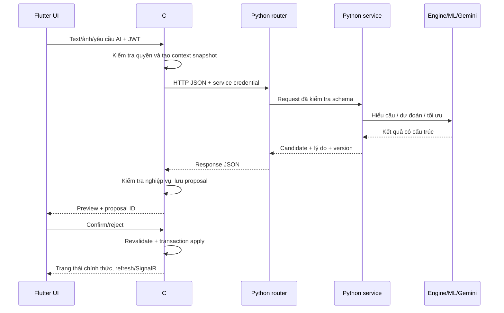

# KẾ HOẠCH TRIỂN KHAI TOÀN BỘ AI HOUSEKEEPER BẰNG PYTHON

Chore Wars — cập nhật ngày 18/10/2026.

## 0. Phạm vi đã chốt theo yêu cầu

**Backend và frontend nghiệp vụ đã hoàn thiện theo xác nhận của chủ dự án. Kế hoạch này chỉ triển khai phần AI và các điểm nối cần thiết để AI giao tiếp với hệ thống hiện có.** Không đưa việc hoàn thiện lại BE/FE vào backlog. Những chức năng AI đang được ghi “future/planned” trong source hoặc tài liệu đều nằm trong phạm vi thực hiện của bản này.

Đích cuối cùng gồm: hiểu tiếng Việt/voice, dự đoán hoàn thành và thời lượng, giao việc thông minh, phát hiện rủi ro, xếp lại lịch, đề xuất đổi việc, học hành vi qua Kafka, tái sử dụng mùa có cải thiện, phân tích chat, việc khẩn cấp/Blitz 30 phút và kiểm tra ảnh bằng chứng.

Các giai đoạn dưới đây là thứ tự triển khai toàn bộ, không phải danh sách tính năng để hoãn vô thời hạn. Không giới hạn bản này vào một intent hoặc lịch 8 ngày cũ. Đây là tài liệu kế hoạch; chưa code hoặc train model trong lần cập nhật này.

Tài liệu đầu vào: báo cáo AI Housekeeper người dùng gửi; `docs/plans/ai-housekeeper-implementation-plan.md`; cấu trúc source Chore Wars. Bản này thay thế phạm vi MVP của `ai-task-allocation-execution-plan.vi.md` cho yêu cầu AI hiện tại. Các đường dẫn ngắn bên dưới tính từ gốc repository.

## 1. Báo cáo phạm vi chức năng AI sẽ triển khai

| Phần | Người dùng nhận được gì? | Python sẽ thực hiện | Dùng model/train? |
|---|---|---|---|
| A — NLU và voice | Nói/nhập “thứ Ba tôi bận”, “tạo việc rửa bát…” | Hiểu intent, trích xuất ngày giờ/thực thể, hỏi lại khi thiếu | Gemini có sẵn; không tự train ngôn ngữ |
| B — Prediction | Biết việc nào dễ trễ và thời lượng dự kiến | Dự đoán từng cặp người–việc–thời điểm | Tự train classifier và regressor |
| C — Allocation/replan | Có đề xuất giao lịch hoặc sửa phần lịch bị ảnh hưởng | Lọc điều kiện, tối ưu Karma, rotation, preference và rủi ro | Thuật toán + đầu ra ML |
| D — Swap | Tìm người/cặp việc phù hợp để đổi | Tìm phương án hai bên hợp lệ, so sánh trước/sau | Thuật toán + prediction |
| E — Urgent/Blitz | Chia nhiệm vụ và người làm trong ngân sách 30 phút | Gemini tách việc; optimizer tính lịch, song song/phụ thuộc | Gemini + thuật toán + duration model |
| F — Risk insights | Nhận cảnh báo việc có nguy cơ trễ, có lý do | Đánh giá batch, xếp ưu tiên, loại cảnh báo trùng | Classifier + rule |
| G — Chat intelligence | Nhận gợi ý từ câu báo bận/nhờ đổi việc trong phòng | Tách insight từ context giới hạn, tạo candidate action | Gemini + chống trùng |
| H — Habit learning | Lịch mới phản ánh dữ liệu lịch sử thực tế | Nhận sự kiện, thống kê thói quen, cập nhật feature | Thống kê liên tục + retrain theo đợt |
| I — Season evolution | “Dùng lại mùa trước và cải thiện lịch” | Đề xuất mùa mới, thay đổi có giải thích, giữ fairness | Habit + prediction + optimizer |
| J — Vision | Nhận đánh giá ảnh theo việc cần hoàn thành | Kiểm tra ảnh phù hợp, bằng chứng thấy được, kết quả chưa chắc chắn | Gemini multimodal, không tự train vision |
| K — Vòng đời ML | Xem model đã train bằng gì và chất lượng ra sao | Dataset, training job, metrics, registry, promotion, rollback | Hạ tầng cho hai model tự train |

AI chỉ đề xuất. C# tiếp tục quyết định quyền, kiểm tra nghiệp vụ và ghi dữ liệu. “Tự tiến hóa mùa giải” nghĩa là tự tính bản đề xuất tốt hơn, sau đó người có quyền xác nhận áp dụng.

## 2. Dùng Python như thế nào?

Tạo service độc lập **`ai-service/`**, Python 3.12, FastAPI. Chọn CPU cho bản đầu; không yêu cầu GPU. Khóa phiên bản thư viện sau khi kiểm tra tương thích trên môi trường chạy.

| Công nghệ | Vai trò cụ thể |
|---|---|
| FastAPI, Uvicorn | Nhận HTTP JSON từ C# |
| Pydantic, pydantic-settings | Contract, cấu hình, kiểm tra kiểu và giới hạn dữ liệu |
| google-genai | Gọi Gemini với structured output, text và ảnh |
| scikit-learn | Pipeline tiền xử lý, train, evaluate, predict |
| pandas, NumPy | Biến sự kiện/lịch sử thành bảng dữ liệu và feature |
| joblib | Lưu/nạp pipeline đã train từ artifact nội bộ tin cậy |
| confluent-kafka | Consumer sự kiện nghiệp vụ và publisher kết quả AI |
| SQLAlchemy, psycopg, Alembic | Kho dữ liệu do AI sở hữu và migration riêng |
| httpx | Giao tiếp HTTP nội bộ khi cần lấy context/ảnh hợp lệ |
| pytest, pytest-asyncio | Test API, engine, training và async |

Chạy ba loại process từ cùng một source:

1. **API process:** phục vụ suy luận; nạp model đã được duyệt vào RAM.
2. **Worker process:** nhận Kafka, tổng hợp habit, xử lý chat và tác vụ nền.
3. **Training process:** train/evaluate theo job; không chiếm luồng HTTP.

Kho AI dùng PostgreSQL database riêng `chorewars_ai` hoặc database riêng trên cùng PostgreSQL instance. Python chỉ có credential của kho AI. Dữ liệu nghiệp vụ đi qua API snapshot và Kafka từ C#, không query trực tiếp bảng nghiệp vụ.

Artifacts lưu trên volume bền vững khi chạy một máy; khi triển khai nhiều instance dùng object storage và registry chung. Không để model, dataset hay habit quan trọng chỉ nằm trên filesystem tạm của container.

## 3. Model nào phù hợp cho ứng dụng mobile?

### 3.1. Quyết định lựa chọn

| Tác vụ | Lựa chọn ban đầu | Chạy ở đâu? | Có tự train không? |
|---|---|---|---|
| Hiểu lệnh Việt, phân tích chat, chia việc | **`gemini-3.5-flash-lite`** | Google API, được Python gọi | Không |
| Kiểm tra ảnh và diễn giải ca phức tạp | **`gemini-3.8-flash`** | Google API, được Python gọi | Không |
| Xác suất hoàn thành đúng hạn | **RandomForestClassifier** | Server Python | Có |
| Thời lượng thực hiện | **RandomForestRegressor** | Server Python | Có |
| Baseline để đối chiếu model | LogisticRegression/DummyClassifier; median/DummyRegressor | Server Python | Có/ước lượng thống kê |
| Phân công, swap, replan, evolution | Greedy có ràng buộc + local search | Server Python | Không train; sử dụng dự đoán ML |
| Microphone/loa | Engine STT/TTS Android/iOS qua Flutter | Thiết bị/dịch vụ hệ điều hành | Không tự train |

Google hiện công bố Flash-Lite cho tác vụ trích xuất với ưu tiên tốc độ/chi phí; cả hai model được chọn hỗ trợ ảnh và structured output. Đây là cơ sở lựa chọn ban đầu; chất lượng tiếng Việt và ảnh việc nhà phải được đo trên bộ eval của Chore Wars. [Flash-Lite](https://ai.google.dev/gemini-api/docs/models/gemini-3.5-flash-lite), [Flash](https://ai.google.dev/gemini-api/docs/models/gemini-3.8-flash).

Không mặc định `gemini-2.5-flash` như tài liệu cũ: trang model hiện hướng dự án mới sang các model mới và ghi hạn chế truy cập dòng 2.5. Tên model là cấu hình `GEMINI_TEXT_MODEL` và `GEMINI_VISION_MODEL`, không rải trong code. [Danh sách model](https://ai.google.dev/gemini-api/docs/models).

Random Forest được chọn vì bài toán đầu vào dạng bảng, dùng CPU và dễ bắt đầu với người mới. Đây là lựa chọn kỹ thuật của dự án, không phải bảo đảm sẽ thắng mọi model hoặc mọi dataset. Sẽ giữ model baseline nếu model phức tạp hơn chưa cải thiện thực tế. [Classifier](https://scikit-learn.org/stable/modules/generated/sklearn.ensemble.RandomForestClassifier.html), [Regressor](https://scikit-learn.org/stable/modules/generated/sklearn.ensemble.RandomForestRegressor.html).

### 3.2. Vì sao mobile không phải tải model này?

Luồng là **Flutter → C# → Python → model/API**. Điện thoại chỉ gửi text/ảnh đã tối ưu và hiển thị kết quả. APK không chứa Random Forest, Gemini hoặc API key. Người dùng không cần điện thoại có NPU/GPU để dùng tính năng chính; cần kết nối server.

Voice dùng engine của hệ điều hành. Khả năng nhận tiếng Việt, chạy offline và độ trễ phụ thuộc thiết bị/engine/gói ngôn ngữ; phải kiểm tra trên điện thoại mục tiêu. Không hứa STT “0 ms”, offline trên mọi máy hay không tăng dung lượng app.

Không cần tự train LLM, LoRA, mô hình nhận giọng nói hoặc mô hình vision cho phạm vi này. Hai model tự train chính là **dự đoán đúng hạn** và **dự đoán thời lượng**. Vision model đánh giá ảnh, không phải model sinh ảnh.

### 3.3. Hiệu năng và chi phí

- Đo p50/p95 trên server thực tế với batch 10/100/1.000 cặp người–việc; không ghi trước model luôn chạy dưới 5 ms hay file luôn dưới 500 KB.
- Gọi prediction theo batch; chỉ gọi Gemini khi có ngôn ngữ/ảnh cần hiểu hoặc cần diễn đạt.
- Giới hạn token, số message context, kích thước ảnh, số lần retry và ngân sách từng house.
- Có semaphore/rate limit cho Gemini; cache theo input hash + prompt/model version khi phù hợp.
- API timeout trả trạng thái rõ; tác vụ train hoặc phân tích dài trả job ID để mobile truy vấn qua C#.
- Không tự nâng cấp model đắt hơn trên mọi lỗi; chỉ fallback cấu hình được và trong ngân sách.

## 4. Kiến trúc source Python

```text
ai-service/
├── pyproject.toml                    # Dependencies và cấu hình lint/test
├── uv.lock                           # Khóa dependency khi triển khai
├── Dockerfile
├── .env.example
├── README.md                         # Hướng dẫn chạy, train, predict
├── alembic.ini
├── migrations/                       # Chỉ migration kho AI
├── contracts/
│   ├── openapi.json                  # Contract HTTP xuất từ FastAPI
│   ├── events/v1/                    # JSON schema Kafka
│   └── examples/                     # Request/response dùng chung C#/Python
├── app/
│   ├── __init__.py
│   ├── main.py                       # FastAPI app, lifespan, đăng ký router
│   ├── config.py                     # Env/settings
│   ├── dependencies.py               # Wiring service, repository, predictor
│   ├── api/
│   │   ├── health.py
│   │   ├── security.py               # Service auth, admin scope
│   │   ├── middleware.py             # Request ID, lỗi, giới hạn request
│   │   └── v1/
│   │       ├── nlu.py
│   │       ├── predictions.py
│   │       ├── schedules.py           # propose/replan/swap/evolve
│   │       ├── urgent.py
│   │       ├── chat.py
│   │       ├── vision.py
│   │       └── training.py            # Tạo job, xem metrics/status
│   ├── schemas/
│   │   ├── common.py                 # Envelope, IDs, errors, context
│   │   ├── context.py                # Members, chores, availability, snapshot
│   │   ├── nlu.py
│   │   ├── prediction.py
│   │   ├── schedule.py
│   │   ├── urgent.py
│   │   ├── chat.py
│   │   ├── vision.py
│   │   ├── events.py
│   │   └── training.py
│   ├── services/
│   │   ├── nlu_service.py
│   │   ├── prediction_service.py
│   │   ├── allocation_service.py
│   │   ├── replan_service.py
│   │   ├── swap_service.py
│   │   ├── evolution_service.py
│   │   ├── urgent_service.py
│   │   ├── chat_service.py
│   │   ├── vision_service.py
│   │   ├── habit_service.py
│   │   └── explanation_service.py
│   ├── engines/
│   │   ├── eligibility.py            # Lọc hard constraint
│   │   ├── fairness.py               # Tính Karma, variance, rotation
│   │   ├── assignment_optimizer.py   # Greedy + local search giới hạn
│   │   ├── swap_optimizer.py
│   │   ├── blitz_optimizer.py        # Timeline/parallelism/dependency
│   │   ├── risk_policy.py            # Threshold, cảnh báo, hysteresis
│   │   └── time_policy.py            # UTC, timezone, date interval
│   ├── clients/
│   │   ├── gemini_client.py
│   │   └── core_context_client.py    # Snapshot bổ sung nếu contract cho phép
│   ├── prompts/
│   │   ├── nlu_v1.txt
│   │   ├── chat_v1.txt
│   │   ├── urgent_v1.txt
│   │   ├── vision_v1.txt
│   │   └── explanation_v1.txt
│   ├── ml/
│   │   ├── dataset_builder.py        # Assignment/outcome → dòng train
│   │   ├── feature_builder.py        # Một cách tạo feature cho train và predict
│   │   ├── preprocessing.py
│   │   ├── baselines.py
│   │   ├── train_completion.py
│   │   ├── train_duration.py
│   │   ├── evaluate.py
│   │   ├── predictor.py              # Nạp version đã promote, batch inference
│   │   ├── cold_start.py             # Chưa đủ data/model → fallback rõ nguồn
│   │   ├── registry.py               # Version, metadata, promote/rollback
│   │   └── synthetic.py              # Dataset demo tách biệt dữ liệu thật
│   ├── messaging/
│   │   ├── consumer.py               # Poll Kafka, validate schema, commit offset
│   │   ├── handlers.py               # Routing event → xử lý
│   │   ├── publisher.py              # Kết quả AI → topic ai.insight.created
│   │   └── outbox.py                 # Phát sự kiện AI sau khi ghi kho AI
│   ├── storage/
│   │   ├── db.py
│   │   ├── models.py                 # Bảng telemetry/habit/jobs/registry
│   │   ├── repositories.py
│   │   └── artifact_store.py         # Local volume/object storage adapter
│   └── workers/
│       ├── telemetry_worker.py
│       ├── training_worker.py
│       └── risk_worker.py
├── scripts/
│   ├── seed_demo.py
│   ├── export_dataset.py
│   ├── train.py
│   ├── evaluate.py
│   ├── promote_model.py
│   └── predict_sample.py
├── tests/
│   ├── unit/
│   ├── integration/
│   ├── contracts/
│   └── fixtures/
├── evals/
│   ├── vietnamese_nlu.jsonl
│   ├── chat_cases.jsonl
│   ├── vision_manifest.jsonl
│   └── run_evals.py
├── data/                             # Runtime/local development, gitignore
└── artifacts/                        # Runtime model bundles, gitignore
```

Nguyên tắc gọi file: **router → service → engine/ML/client → repository**. Router không viết thuật toán. Engine không gọi HTTP/DB. `feature_builder.py` dùng chung train và inference để thứ tự/ý nghĩa cột không lệch. `dependencies.py` cung cấp instance, tránh module tự tạo client và model ở mọi request. Các package có `__init__.py` khi cần.

Ví dụ: `api/v1/schedules.py` đọc `AllocationRequest`, gọi `allocation_service.py`; service lấy habit qua repository, gọi `predictor.py` và `assignment_optimizer.py`; kết quả được `explanation_service.py` diễn đạt; router trả `AllocationResponse`.

## 5. Giải thích train AI từ đầu

### 5.1. Những từ cần biết

| Từ | Hiểu trong Chore Wars |
|---|---|
| Dataset | Bảng lịch sử các lần giao việc và kết quả |
| Một sample | Một lần giao một occurrence cho một người tại một thời điểm |
| Feature/X | Thông tin đã biết khi giao: độ khó, tải, lịch sử đúng hạn… |
| Label/y | Kết quả muốn model học: đúng hạn 1/0 hoặc số phút làm thật |
| Train/fit | Cho thuật toán học quan hệ X → y từ dữ liệu quá khứ |
| Validation | Dữ liệu chọn tham số, threshold và kiểm tra trước khi chốt |
| Test | Dữ liệu giữ riêng để đánh giá cuối, không dùng điều chỉnh model |
| Inference/predict | Dùng model đã train để dự đoán lần giao việc mới |
| Artifact | File pipeline đã học và metadata, không phải source code |
| Retrain | Train phiên bản mới bằng dataset cập nhật |

Ví dụ minh họa, không phải dữ liệu đã thu thập:

| Difficulty | Phút chuẩn | Karma | Tải tuần | Tỷ lệ đúng hạn trước đó | Kết quả đúng hạn | Phút làm thật |
|---|---:|---:|---:|---:|---:|---:|
| MEDIUM | 30 | 20 | 90 | 0,8 | 1 | 27 |
| HARD | 60 | 40 | 300 | 0,5 | 0 | 75 |

Model đúng hạn học 5 cột đầu → cột kết quả 1/0; duration model học đầu vào → phút thật. Trên source sẽ có thêm feature đủ context và mã hóa category.

### 5.2. Chính xác dữ liệu train lấy từ đâu?

**Model completion:** theo dõi một assignment episode từ lúc gán đến khi hoàn thành, hết hạn, hủy hoặc chuyển người. Một occurrence đổi người có nhiều episode; không đổ kết quả cuối cùng cho mọi người từng được giao.

- `y_on_time = 1` khi người chịu trách nhiệm hoàn thành trước/đúng due time.
- `y_on_time = 0` khi đã qua due time mà episode vẫn chịu trách nhiệm và chưa hoàn thành; cần chốt watermark/grace dữ liệu cho event tới trễ.
- Episode chưa đến hạn chưa có label; việc bị hủy không ép thành trễ; chuyển người trước hạn đóng episode với outcome riêng, mặc định loại khỏi tập binary nếu không có outcome đủ rõ.
- Bounty là tín hiệu nghiệp vụ; không tự gắn “né tránh” hoặc label thất bại cho mọi người tạo bounty.

**Model duration:** cần `work_started_at`, `work_completed_at`, `active_duration_seconds` hoặc phiên timer có pause/resume được nghiệp vụ xác minh. Khi chưa có trường này, chỉ implement đủ pipeline/regressor và chạy demo; runtime dùng estimated duration/median phù hợp với `source=FALLBACK`. Không lấy `CompletedAt - DueDate` hay `CompletedAt - AssignedAt` làm thời gian thực hiện.

Đây là yêu cầu đầu vào AI, không phải yêu cầu làm lại nghiệp vụ BE/FE. Điểm nối hiện có cần cung cấp outcome/timer qua contract; nếu không có nhãn thực thì không thể báo model duration đã được học bằng dữ liệu người dùng thật.

### 5.3. Feature sẽ code

- Difficulty, estimated minutes, snapshot Karma, loại/tần suất chore.
- Thứ, giờ deadline, khoảng cách từ thời điểm giao đến deadline, timezone chuẩn.
- Số việc/phút/Karma đã được giao trong ngày và tuần tại thời điểm dự đoán.
- Tỷ lệ đúng hạn trước thời điểm giao, số mẫu, số lần overdue, thời gian hoàn thành trung vị nếu đủ nhãn.
- Lịch sử theo loại việc/chore tương đương, rotation gần đây, preference khai báo.
- Tín hiệu bounty/reassignment có context; không thay thế consent và hard constraint.
- Availability overlap khi có time interval; thiếu dữ liệu có missing indicator.

`user_id` và `house_id` dùng liên kết dữ liệu; bản đầu không one-hot tất cả ID để tránh chỉ học thuộc người. Chore type/category và profile thống kê giúp dùng được cho người/việc mới. Không đưa outcome tương lai vào feature.

Tất cả feature lịch sử phải là **as-of**: chỉ tính từ sự kiện đã biết trước lúc assignment. Ví dụ train dòng ngày 10 không được dùng tỷ lệ đúng hạn đã tính cả ngày 20. Lưu feature snapshot hoặc tái dựng từ lịch sử có timestamp/version.

### 5.4. Pipeline sẽ xây từng bước

1. `dataset_builder.py` ghép assignment episode và outcome, đánh dấu nguồn `REAL`/`SYNTHETIC`, loại bản ghi trùng/hủy/thiếu nhãn.
2. `feature_builder.py` tạo X, label builder tạo y theo định nghĩa trên.
3. Chia theo thời gian train/validation/test; cùng occurrence/episode liên quan không rơi vào nhiều tập. Khoảng chia minh họa 70/15/15, điều chỉnh theo số mẫu/thời gian.
4. `preprocessing.py`: impute missing, encode category chưa thấy; fit transformer chỉ trên tập train.
5. `baselines.py`: tỷ lệ nền/logistic cho completion, median cho duration.
6. `train_completion.py`: RandomForestClassifier, tham số khởi đầu gợi ý 200 trees, depth giới hạn, min leaf >1; tuning nhỏ trên validation, cố định random seed.
7. `train_duration.py`: RandomForestRegressor với nhãn phút thực hợp lệ; kiểm tra giá trị bất thường, không âm/0 giả.
8. `evaluate.py`: đo chất lượng và hiệu năng; nếu muốn gọi đầu ra là xác suất thì kiểm tra calibration, hiệu chỉnh trên validation riêng nếu đủ dữ liệu hai lớp.
9. `registry.py`: lưu bundle pipeline, metrics, feature/schema version, thời gian cutoff, dữ liệu nguồn và checksum.
10. Model candidate được promote khi vượt gate; API nạp bản approved, có thể rollback model cũ.

Minh họa ý tưởng, không phải implementation đầy đủ:

```python
pipeline.fit(x_train, y_train)
probabilities = pipeline.predict_proba(x_test)[:, positive_class_index]
joblib.dump(pipeline, artifact_path)
```

Phần code thật phải lấy đúng index của class `1`, kiểm tra dataset có cả hai lớp và version feature tương thích, không mặc định mọi file model đều đúng schema.

### 5.5. Chưa có dữ liệu thì làm gì?

Triển khai đầy đủ cả hai chế độ ngay từ đầu:

- **Demo training:** `synthetic.py` tạo dataset có seed và noise để chạy được toàn bộ quy trình train → evaluate → save → predict. Model/artifact ghi `DEMO_SYNTHETIC`, không tự promote sang production.
- **Runtime thật:** dùng rule/profile aggregate và estimated minutes khi chưa đủ dữ liệu; response có `prediction_source=RULE_FALLBACK`, số mẫu và giới hạn.
- **Real training:** khi dữ liệu thật có cả outcome, đủ phân bố và holdout đánh giá được, job tạo candidate thật; không có con số 1.000/2.000 dòng nào bảo đảm chất lượng.
- Model đúng hạn và duration có thể đạt điều kiện ở hai thời điểm khác nhau; version/fallback độc lập.

Như vậy toàn bộ tính năng vẫn được code và demo, đồng thời phân biệt chính xác “pipeline đã hoạt động” với “model đã học tốt từ người dùng thật”.

### 5.6. Đánh giá model và tự học

- Completion: PR-AUC khi đủ hai lớp, precision/recall/F1 theo threshold, Brier/log loss và calibration. Accuracy chỉ là số phụ khi dữ liệu lệch lớp.
- Duration: MAE theo phút, median absolute error, so với median/estimate baseline, số mẫu theo nhóm việc.
- Chia holdout gần đây theo thời gian; thêm đánh giá nhà/người chưa thấy để kiểm tra khả năng tổng quát.
- Random Forest không tự `partial_fit` sau từng Kafka message. Kafka cập nhật dataset/habit; job train theo đợt mới tạo model version khác.
- Lịch gợi ý: kiểm tra hằng đêm xem đủ outcome mới không, nếu đủ thì train candidate; train không đạt gate giữ model cũ. Dùng lock để tránh hai job promote chồng nhau.
- Test được viết cả cho dữ liệu một lớp, thiếu label, model không có, sai feature version và artifact hỏng.

### 5.7. Người chưa từng train sẽ chạy gì?

Các lệnh dự kiến sau khi code xong, chạy từ `ai-service/`:

```powershell
uv sync
uv run python -m scripts.seed_demo --rows 2000 --seed 42
uv run python -m scripts.train --dataset demo --target completion
uv run python -m scripts.train --dataset demo --target duration
uv run python -m scripts.evaluate --run-id <run-id>
uv run python -m scripts.promote_model --run-id <run-id> --environment demo
uv run python -m scripts.predict_sample --environment demo
uv run uvicorn app.main:app --host 0.0.0.0 --port 8085
```

Kết quả bàn giao: dataset manifest, model `.joblib`, `metrics.json`, `metadata.json`, ví dụ input/output và README giải thích từng lệnh. Lệnh trên là giao diện sẽ xây, chưa phải script đang tồn tại.

API startup chỉ nạp model hoặc chuyển fallback; không tự train blocking lúc startup. Chỉ nạp artifact do pipeline nội bộ tạo, khóa version dependency tương ứng.

## 6. Các engine AI sẽ code cụ thể

### 6.1. NLU/voice

Intent: cập nhật availability, tạo chore, xin phân công, xin đổi việc, clone/evolve season, lập urgent/Blitz. Gemini trả schema gồm intent, entities, missing fields, temporal scope và suggested action.

- `nlu_service.py` truyền thời gian hiện tại/timezone do C# cung cấp; không để model tự đoán “hôm nay”.
- Phân biệt thứ lặp lại với ngày cụ thể, cả ngày với khung giờ; output theo đúng capability contract của C#.
- Tên người/việc được resolve từ danh sách context; trùng tên phải hỏi lại; sender/user lấy từ context xác thực.
- Trả `NEEDS_CLARIFICATION` khi thiếu, `UNSUPPORTED` khi thật sự ngoài phạm vi, không giả thành công.
- Gemini structured output hỗ trợ cấu trúc; Pydantic và semantic validation vẫn kiểm tra ngày giờ, quyền và ý nghĩa. [Structured output](https://ai.google.dev/gemini-api/docs/structured-output).

### 6.2. Allocation và replan

`eligibility.py` lọc thành viên active, availability, deadline khả thi, giới hạn phút/ngày/việc/tuần, item được phép thay đổi và consent policy. Đầu vào có existing assignment, frozen item và policy từ C#.

`assignment_optimizer.py` ưu tiên theo thứ tự: không vi phạm hard constraint → giao được việc khả thi → cân bằng Karma → giảm rủi ro → preference/rotation → giảm thay đổi. Có tie-break ổn định và local search giới hạn thời gian/số vòng.

- Workload fairness dùng Karma dự kiến được giao, không dùng Karma balance đã kiếm được.
- Phút là giới hạn khả năng và ngân sách Blitz; không đánh tráo thành tiêu chí fairness chính của mùa.
- Không có người hợp lệ thì trả unassigned + constraint reason, không ép giao người bận.
- Model risk chỉ là mục tiêu phụ để người bị đánh giá rủi ro cao không bị loại khỏi mọi việc mãi mãi.
- Replan mặc định sửa tập occurrence tương lai được phép; không sửa completed/canceled hoặc item bị khóa bởi payment/bounty/policy.
- Trả thay đổi trước/sau, delta Karma/risk, constraint checks và người cần xác nhận.

### 6.3. Swap

`swap_service.py` lấy việc muốn đổi, tìm người/cặp việc đối ứng; optimizer kiểm tra ngày/giờ, workload, trạng thái và fairness sau đổi. Cùng Karma là ứng viên ưu tiên, không phải điều kiện đủ.

Kết quả: tối đa vài phương án có lý do, mức thay đổi Karma và required approvers. Nếu policy bảo toàn Karma từng người yêu cầu chính xác mà không có cặp phù hợp, trả không có phương án; không tự nới luật. C# quản lý xác nhận cả hai bên và transaction apply.

### 6.4. Habit và evolution

`habit_service.py` duy trì theo user/house/chore category: số mẫu, tỷ lệ đúng hạn có smoothing, giờ hoàn thành quan sát được, duration median nếu có, tín hiệu reassignment và preference khai báo.

- Giờ bấm hoàn thành là giờ ghi nhận sự kiện, chưa chứng minh đó là giờ bắt đầu/rảnh.
- Bounty là tín hiệu cần context, không suy ra “lười/ghét việc”.
- Dữ liệu mới ít dùng prior; profile gắn `sample_count`, `as_of`, `data_quality`.

`evolution_service.py` nhận source season và target draft context, map chore cũ sang template mới, đối chiếu membership/availability hiện tại, gọi prediction và optimizer. Giữ assignment hợp lệ đang tốt, thay phần có lợi ích đo được; trả rationale dựa trên dữ liệu. Không hỏi lại dữ liệu đã có; chỉ hỏi phần thiết yếu còn thiếu hoặc mơ hồ.

### 6.5. Chat intelligence

`chat_service.py` nhận message/context giới hạn trong một room, phát hiện báo bận, yêu cầu/thỏa thuận đổi việc và vấn đề vệ sinh cần xử lý. Văn bản chat được coi là nội dung để phân tích, không là lệnh quản trị được tin cậy.

- Chạy khi được gọi hoặc theo cơ chế room opt-in đã cấu hình; lọc message bot để tránh vòng lặp.
- Dùng message ID/context version chống gửi cùng insight nhiều lần.
- Quote/span liên quan đi cùng output để người dùng hiểu gợi ý xuất phát từ câu nào.
- Không coi câu nói của A là quyền sửa lịch B. Candidate action phải qua proposal/consent.
- “Mâu thuẫn” chỉ trả vấn đề quan sát được cần làm rõ, không chấm điểm tính cách hay kết luận ý đồ người dùng.

### 6.6. Urgent/Blitz

Gemini tách yêu cầu thành micro-task có duration estimate và dependency. `blitz_optimizer.py` xếp task cho người đã tham gia, kiểm tra tài nguyên, dependency và việc có thể làm song song.

Ví dụ 3 người × 30 phút tối đa 90 person-minutes nếu không có dependency/tắc tài nguyên. Mỗi người không vượt 30 phút; thời gian hoàn tất toàn chiến dịch là độ dài lịch có dependency, không phải chỉ tổng phút chia người.

Output gồm task, người, start offset/end offset, critical path, tổng phút/người, phần không đủ thời gian. Không tự đặt Karma ngoài policy C#; đọc bảng/policy hoặc trả `suggested_karma` để C# phê duyệt. Khi mọi người xác nhận, C# tạo session với `starts_at/ends_at` dùng cho countdown; Python không phát tick mỗi giây.

### 6.7. Vision

`vision_service.py` gửi mô tả chore, checklist và ảnh hợp lệ sang Gemini Flash. Output: `PASS`, `FAIL`, `UNCERTAIN`, observations, missing evidence và model version; có thể cung cấp adapter `is_valid` cho contract cũ, trong đó `UNCERTAIN` phải được giữ rõ.

- Ảnh mờ/sai góc/không thấy vùng cần kiểm tra → `UNCERTAIN`, yêu cầu chụp lại.
- Ảnh cho thấy chén đã xếp gọn không chứng minh ai làm, lúc nào làm hay không gian khác cũng sạch.
- Điểm confidence nếu model trả về là tự đánh giá, không xem như xác suất đã được hiệu chuẩn.
- Không tự động phạt Karma/kết luận gian lận; C# quyết định completion theo policy, có người xem lại khi cần.
- Nhận object reference hoặc signed URL từ kho được cho phép; giới hạn MIME/kích thước, không fetch URL tùy ý. Chỉ gửi metadata/ảnh cần thiết.

## 7. Contract HTTP, event và dữ liệu

### 7.1. Endpoint Python thống nhất

| Endpoint | File router | Service |
|---|---|---|
| `GET /health/live`, `/health/ready` | `api/health.py` | Model/storage readiness |
| `POST /v1/nlu/interpret` | `api/v1/nlu.py` | `nlu_service.py` |
| `POST /v1/predictions/evaluate-batch` | `api/v1/predictions.py` | `prediction_service.py` |
| `POST /v1/schedules/propose` | `api/v1/schedules.py` | `allocation_service.py` |
| `POST /v1/schedules/replan` | Cùng trên | `replan_service.py` |
| `POST /v1/schedules/swap` | Cùng trên | `swap_service.py` |
| `POST /v1/seasons/evolve` | Cùng trên | `evolution_service.py` |
| `POST /v1/urgent/plan` | `api/v1/urgent.py` | `urgent_service.py` |
| `POST /v1/chat/insights` | `api/v1/chat.py` | `chat_service.py` |
| `POST /v1/vision/verify-proof` | `api/v1/vision.py` | `vision_service.py` |
| `POST /v1/ml/training-jobs` | `api/v1/training.py` | Ghi job cho training worker |
| `GET /v1/ml/training-jobs/{id}` | Cùng trên | Status/log summary |
| `GET /v1/ml/models/active` | Cùng trên | Model metadata/metrics |

Các đường `/ai/...` trong tài liệu cũ là tên đề xuất trước đây; khi code chọn contract `/v1/...` này và cấu hình client C# tương ứng, không duy trì hai bộ tên khác nhau vô tình.

Request dùng snake_case bên Python với mapping JSON tường minh ở C#. Common fields: `schema_version`, `request_id`, `house_id`, `actor_id`, `season_id` nếu liên quan, `context_version`, `now_utc`, `timezone`, `policy_version`. ID thật là UUID; ID task mới chưa persist dùng `client_reference`, không giả là UUID nghiệp vụ.

Response chung: status, request ID, input context version, model/prompt/feature version, prediction source, result, warnings, missing fields. Lỗi có mã máy đọc được. Prediction có `sample_count`; plan có before/after, unassigned, constraint reasons và required approvers.

Python trả **candidate action**, không tạo proposal nghiệp vụ trong DB C#. Sau khi kiểm tra, C# tạo proposal ID, hạn dùng và trạng thái của mình. Confirm phải dùng payload server lưu, kiểm tra lại context version và ghi đúng một lần. Đây là adapter AI, không thiết kế lại module giao dịch đã có.

### 7.2. Kafka

Consume: `chore.completed`, `chore.overdue`, `bounty.created`, `bounty.accepted`, `bounty.expired`, `season.ended`, `chat.message_sent`. Để train chính xác cần thêm/nhận equivalent event cho assignment created/reassigned/cancelled, membership change và timer outcome. Backfill lịch sử qua endpoint/export do C# kiểm soát.

Envelope bắt buộc: `event_id`, `schema_version`, `event_type`, `occurred_at`, `published_at`, `house_id`, `aggregate_id`, `aggregate_version`, payload. Payload assignment/outcome cần episode ID, assignee tại thời điểm event, occurrence/season/chore ID, due time và snapshot cần thiết. Timer event thêm duration có nguồn xác minh.

1. Consumer nhận event, kiểm tra schema.
2. Transaction kho AI ghi raw event unique theo event_id, cập nhật episode/habit và outbox kết quả nếu có.
3. Commit DB rồi commit offset. Event lặp được dedup, không tăng counter lần nữa.
4. Event tới sai thứ tự xử lý bằng version/time, lưu pending và reconcile; poison message vào DLQ kèm lỗi.
5. Insight/action phát qua `ai.insight.created`, C# consumer kiểm tra house/context, tạo proposal hoặc notification/SignalR.

Consumer group Python riêng với group của C#; không tranh event với notification consumer. Kết quả chat giữ message/context reference; late completion có thể sửa label đã đóng theo watermark, kích hoạt rebuild dataset version sau.

### 7.3. Kho AI sẽ có những bảng nào?

`raw_events`, `assignment_episodes`, `outcomes`, `habit_profiles`, `feature_snapshots`, `dataset_manifests`, `training_jobs`, `model_versions`, `prediction_audits`, `insight_dedup`, `outbox_messages`.

Partition/filter theo house; index theo event ID, occurrence/episode và timestamp. Bản dataset/artifact có version và manifest. Không ghi đè dữ liệu training đang được một job đọc. Đặt retention cho chat/ảnh và hỗ trợ xóa dữ liệu liên quan theo policy dự án.

## 8. Luồng đi: các file giao tiếp ra sao?

Tên file AI ở C#/Flutter dưới đây là **điểm nối sẽ thêm hoặc map sang phần tương đương đã có**, không khẳng định source hiện có đã có các class này.

### Luồng tổng quan



### 8.1. Người dùng nói “thứ Ba tôi bận”

```text
ai_housekeeper_screen.dart
 → voice_service.dart (nếu dùng mic; cho kiểm tra transcript)
 → ai_repository.dart → ai_remote_data_source.dart → api_client.dart
 → AIHousekeeperController.cs → AIHousekeeperService.cs
 → AIHousekeeperHttpClient.cs
 → app/api/v1/nlu.py
 → app/services/nlu_service.py
 → app/prompts/nlu_v1.txt + app/clients/gemini_client.py
 → app/schemas/nlu.py: validate output
 → JSON về C# → proposal cập nhật availability
 → ai_proposal_card.dart hiển thị preview
 → Confirm → C# apply → availability_screen.dart tải lại
```

NLU không tự đổi lịch active. Nếu người dùng yêu cầu xếp lại sau báo bận, tạo candidate replan riêng với consent theo policy.

### 8.2. Giao việc thông minh cho một mùa

```text
review_schedule_screen.dart / nút đề xuất ở draft
 → Flutter AI datasource → C# AI service lấy snapshot
 → Python api/v1/schedules.py
 → allocation_service.py
   → storage/repositories.py lấy habit as-of
   → prediction_service.py → ml/feature_builder.py → ml/predictor.py
   → engines/eligibility.py
   → engines/assignment_optimizer.py → engines/fairness.py
   → explanation_service.py (reason codes; Gemini diễn đạt khi cần)
 → schemas/schedule.py → C# validate + proposal
 → UI xem Karma, rủi ro, người được giao, việc chưa xếp
 → Confirm → C# apply → SignalR/refresh lịch
```

Pipeline dùng model hoặc cold-start fallback mà không đổi contract. Mọi dự đoán gắn nguồn/version để giải thích được.

### 8.3. Risk và replan

`risk_worker.py` hoặc C# scheduler gửi batch → `api/v1/predictions.py` → `prediction_service.py` → `predictor.py` → `engines/risk_policy.py` → risk insights. Nếu người dùng chọn xếp lại: `/schedules/replan` → `replan_service.py` → eligibility + optimizer → change set → C# proposal. Threshold cảnh báo có cooldown/hysteresis để tránh spam khi điểm dao động quanh ngưỡng.

### 8.4. Đổi việc

Chore detail → `/schedules/swap` → `swap_service.py` → predictor + `swap_optimizer.py` → ứng viên và chênh lệch Karma → C# proposal có danh sách approver → hai bên xác nhận → C# apply một transaction. Python không quyết định thay sự đồng ý của người nhận.

### 8.5. Dùng lại mùa trước

Create season/reuse → C# cung cấp source season, target template mapping và context hiện tại → `/seasons/evolve` → `evolution_service.py` → habit + prediction + optimizer → `explanation_service.py` → trả draft plan/rationale → C# preview/confirm → tạo mùa mới theo nghiệp vụ sẵn có. Không tái sử dụng occurrence ID cũ cho mùa mới.

### 8.6. Kafka và tự học

```text
C# services → IEventPublisher → KafkaEventPublisher.cs → Kafka
 → app/workers/telemetry_worker.py
 → messaging/consumer.py → schemas/events.py → messaging/handlers.py
 → storage/repositories.py (raw event/episode/outcome)
 → services/habit_service.py → habit_profiles
 → ml/dataset_builder.py → dataset version mới
 → training_worker.py kiểm tra điều kiện → train_completion.py/train_duration.py
 → evaluate.py → registry.py → artifact_store.py
 → predictor.py nạp bản được promote
```

Event cập nhật habit gần thời gian thực; trọng số Random Forest thay đổi khi retrain, không đổi ngay sau mỗi event.

### 8.7. Chat gợi ý action card

`chat_room_screen.dart` → luồng chat C# hiện có → event `chat.message_sent` → telemetry worker → `chat_service.py` → prompt/chat + Gemini → candidate insight → AI outbox/publisher → `ai.insight.created` → C# AI insight consumer → proposal/chat card qua SignalR → `ai_action_card.dart`. Confirm card vẫn quay về C#; không gửi confirm tới Python.

Endpoint `/v1/chat/insights` dùng cho gọi trực tiếp/test; dedup chung với đường event để không sinh hai card cho một message.

### 8.8. Blitz 30 phút

Mobile request → C# context → `/v1/urgent/plan` → `urgent_service.py` → Gemini tách micro-task → `blitz_optimizer.py` dùng duration prediction → plan timeline → C# proposal và consent → C# tạo session/task → SignalR gửi `ends_at` → mobile countdown. Mất mạng/reopen tính lại từ giờ server và `ends_at`, không khởi động lại 30 phút.

### 8.9. Vision

Chore detail chụp ảnh → upload C# storage hiện có → C# gọi `/v1/vision/verify-proof` với ảnh/reference có quyền → `vision_service.py` → `gemini_client.py` + `vision_v1.txt` → `schemas/vision.py` → C# áp dụng policy completion → mobile hiển thị nhận xét/kết quả/chụp lại. Timeout không được hiểu là ảnh thất bại hoặc người dùng gian lận.

### 8.10. Train thủ công để học và demo

`scripts/train.py` → dataset builder → feature builder/preprocessing → train target → evaluate → registry/artifact. Người dùng xem metrics rồi chạy promote → API predictor load model approved → `scripts/predict_sample.py` in kết quả. Admin endpoint chỉ tạo job tương đương, trả `202 + job_id`; không chạy `.fit()` ngay trong HTTP handler.

## 9. Điểm nối với BE/FE đã hoàn chỉnh

Phạm vi chỉ bổ sung adapter AI, giữ luồng nghiệp vụ hiện có làm nguồn áp dụng cuối cùng.

| Phía | File/nhóm điểm nối | Phần AI cần thêm/map |
|---|---|---|
| C# Presentation | `AIHousekeeperController.cs` | Nhận yêu cầu từ Flutter, service auth ở Python tách JWT user |
| C# Application | `AIHousekeeperService.cs`, DTO/`IAIHousekeeperClient` | Snapshot, mapping, validate candidate, nối proposal/confirmation |
| C# Infrastructure | `AIHousekeeperHttpClient.cs` | Base URL, timeout, response mapping, request ID |
| C# Messaging | `KafkaEventPublisher.cs`, topic map, AI insight consumer | Event context/episode/timer, nhận gợi ý bất đồng bộ |
| C# hiện có | `SeasonService`, `ChoreAllocationService`, `ChoreService`, `ChatService` | Tái sử dụng nghiệp vụ khi apply; không chuyển quyền ghi DB cho Python |
| Flutter AI | Screen, repository, datasource, provider, proposal/action card | Nhập câu, hiển thị AI result và confirm |
| Flutter hiện có | Availability/review/chat/chore detail | Entry point AI, risk badge, vision feedback, countdown |
| Hạ tầng | `docker-compose.yml`, env | API/worker/trainer, credential nội bộ, volume/database AI |

Nếu project đã có class tương đương thì nối vào đó, tránh tạo bản sao. Các bổ sung dữ liệu như interval availability, episode/timer và action card là contract AI cần nhận/phát; hoàn thành capability tương ứng phải kiểm tra được qua app.

## 10. Thứ tự code toàn bộ và đầu ra từng giai đoạn

Ước lượng dưới đây dành cho một người đã quen C#/Flutter nhưng mới ML, khoảng 7–9 giờ/ngày. Đây là dự toán công việc, không phải cam kết dữ liệu thật sẽ đủ để model đạt chất lượng trong số ngày đó.

| Giai đoạn | Thời lượng dự kiến | Code gì? | Điều kiện hoàn thành |
|---|---:|---|---|
| 1. Contract và service nền | 2 ngày | Skeleton, config, auth, schemas, kho AI, API/worker lifecycle | C# gửi snapshot, Python trả JSON chuẩn; health/auth/test chạy |
| 2. Dataset và ML chạy được | 3 ngày | Episode/outcome builder, feature, demo data, hai trainer, evaluate/registry/fallback | Chạy được train → artifact → predict bằng lệnh; report tách real/demo |
| 3. Prediction và giao việc | 3 ngày | Batch prediction, risk, eligibility, fairness, allocation/replan/swap | Fixture hợp lệ, không phá constraint, reason codes và trước/sau |
| 4. NLU/voice bridge | 2 ngày | Gemini client/prompt/eval, intents, clarification, transcript contract | Câu Việt → candidate → proposal/confirm qua app |
| 5. Kafka và habit/retraining | 3 ngày | Consumer/dedup/out-of-order/DLQ, profile, backfill, job worker | Event thật cập nhật profile; restart/replay không tăng trùng |
| 6. Evolution | 2 ngày | Target mapping, history-aware optimization, rationale | Mùa mới đề xuất dựa context thật, giữ constraint và policy Karma |
| 7. Chat intelligence | 2 ngày | Context extraction, insight publisher, action-card contract | Chat → gợi ý card → confirm → nghiệp vụ đúng; không vòng lặp bot |
| 8. Urgent/Blitz | 2 ngày | Task decomposition, timeline/dependency optimizer, session contract | Mỗi người trong ngân sách; countdown chuẩn sau reopen |
| 9. Vision | 2 ngày | Ảnh input, rubric, PASS/FAIL/UNCERTAIN, evaluation | Ảnh đúng/sai/mờ có kết quả phù hợp, timeout có xử lý |
| 10. Tích hợp, đo và bàn giao | 3 ngày | Contract/e2e/load tests, metrics, Docker, runbook/demo | Tất cả flow chạy qua server/app; model version và giới hạn rõ |

Tổng dự toán khoảng **24 ngày làm việc**, cộng dự phòng 20–30% cho lỗi tích hợp, chất lượng dataset và provider. Không tính thời gian chờ tích lũy lịch sử thực để đủ train production. Có thể rút ngắn nếu các adapter AI đã được làm sẵn; không ép toàn bộ phạm vi này vào lịch 8 ngày tổng thể cũ.

Mọi flow được implement trong các giai đoạn trên. Nếu chưa có nhãn duration thật, chức năng vẫn có code, demo-trained model và fallback runtime; báo cáo ghi đúng trạng thái dữ liệu, không gọi đó là production model đã được kiểm chứng.

## 11. Kiểm thử và nghiệm thu toàn bộ phần AI

| Nhóm | Test bắt buộc | Bằng chứng bàn giao |
|---|---|---|
| Contract | C#/Python cùng fixture, schema version, ngày giờ, ID sai, payload thiếu | Contract examples + kết quả test |
| NLU | Bộ Việt có lóng, phủ định, thiếu thông tin, trùng tên, giờ/ngày tương đối, prompt injection | Intent/entity accuracy và clarification rate trên bộ giữ riêng |
| ML | Không leak outcome, temporal split, một lớp, missing/unseen category, real/demo isolation | Dataset manifest, metrics, baseline comparison |
| Optimizer | Availability, limits, deadline, existing load, unassigned, frozen item, Karma/rotation | Constraint violations = 0 trên fixture; coverage/fairness trước/sau |
| Swap/replan | Hai bên hợp lệ, stale context, không có phương án, bounty/payment lock | Change set + consent scenario |
| Kafka | Duplicate, out-of-order, restart trước/sau commit, schema lạ, DLQ/replay | Counters/episodes không tăng trùng |
| Evolution | Người rời nhà, chore đổi, lịch tốt giữ nguyên, đề xuất không khả thi | Rationale khớp dữ liệu và mapping |
| Chat | Một insight/message/context, bot loop, A nói thay B, câu đùa/phủ định | Candidate đúng và card không tự apply |
| Blitz | Task song song, dependency, tài nguyên chung, không đủ budget, thiếu người | Timeline mỗi người và makespan |
| Vision | Đúng việc/sai việc, mờ, thiếu góc, ảnh lặp, provider lỗi | Human-reviewed eval, false pass/false fail/uncertain rate |
| Mobile e2e | Text/voice/ảnh, preview, reject/confirm, mất mạng sau commit, reopen | Video và checklist từng flow |
| Ops | Restart, model cũ/hỏng, model reload, timeout, rate limit, training job fail | Runbook, metrics, fallback/rollback |

NLU/chat/vision cần bộ evaluation có người gán đáp án và phần giữ riêng; mock test chỉ kiểm tra code/contract, không chứng minh model hiểu đúng. Đo latency/chi phí trên workload thật; threshold nghiệm thu chốt từ baseline và mức chấp nhận của dự án, không bịa kết quả trước khi chạy.

Điều kiện “hoàn chỉnh phần AI”: mọi endpoint/engine/worker có implementation, các flow chạy end-to-end qua app, dữ liệu và model có version, kết quả demo/real ghi rõ nguồn, apply có kiểm tra nghiệp vụ và consent, fallback được test. Không bắt buộc tự train lại LLM/vision mới được coi là có AI.

## 12. Deploy và vận hành

- Docker services: `ai-api`, `ai-worker`; trainer chạy one-shot/job từ cùng image với command riêng. Kafka/AI database dùng mạng nội bộ.
- Env: `AI_DATABASE_URL`, `KAFKA_BOOTSTRAP_SERVERS`, `KAFKA_GROUP_ID`, `CORE_API_BASE_URL`, service credentials, `GEMINI_API_KEY`, hai model name, timeout, concurrency, artifact path/bucket, active environment và model polling interval.
- API chỉ nhận service credential từ C#; training/promotion cần quyền admin riêng. Không mở training endpoint công khai cho mobile.
- Request ID, model version, data version và reason codes ghi log; hạn chế log nguyên văn chat/ảnh. Theo dõi error rate, p95 latency, provider usage, Kafka lag, stale profile, fallback rate và model drift.
- Model reload kiểm tra checksum/schema rồi đổi instance predictor atomically; request đang chạy giữ bundle cũ đến hết. Không train chung một mutable model trong lúc predict.
- CPU-bound prediction nặng chạy qua worker/thread pool có giới hạn; training luôn tách process. Startup không làm Kafka consumer chạy lặp theo số API replicas.
- Nếu không có model real: API ready với khả năng fallback được công bố; hỏng cả dependency cần thiết trả lỗi có kiểm soát. Không health-check bằng cách gọi Gemini tốn phí liên tục.
- Tắt từng feature/model bằng cấu hình, rollback active model version; DB AI và artifact được backup cùng manifest.

## 13. Những điều báo cáo sẽ trình bày đúng

1. **Gọi Gemini không phải tự train Gemini.** Dự án dùng pretrained model cho tiếng Việt/ảnh và tự train hai model tabular.
2. **Tự học gồm hai nhịp:** cập nhật habit sau event; cập nhật model sau training job được đánh giá/promote.
3. **Synthetic data giúp chứng minh pipeline**, không chứng minh khả năng dự đoán hành vi người thật.
4. **Không có duration label thì chưa có duration model thật đáng tin**, dù source/pipeline/regressor đã được code đầy đủ.
5. **JSON đúng cấu trúc chưa bảo đảm đúng nghĩa**; cần semantic checks và eval nghiệp vụ.
6. **Risk không phải bản án cho người dùng**, vision không chứng minh chắc chắn ai đã làm; mọi thay đổi đi qua rule/consent hiện có.
7. **Mobile dùng AI qua server**, không tải các model lên APK; voice phụ thuộc engine thiết bị.
8. **Toàn bộ A–K nằm trong kế hoạch triển khai hiện tại**, không bỏ qua vì source gọi là future.

## 14. Bộ bàn giao cuối cùng

- Source `ai-service/` đầy đủ theo kiến trúc đã mô tả, Docker và env example.
- HTTP OpenAPI, Kafka schema, fixture C#/Python, ví dụ luồng giữa các file.
- Hai pipeline train, dataset demo, lệnh export/train/evaluate/predict/promote.
- Model bundle/version, metrics, baseline report; phân biệt `DEMO_SYNTHETIC`, `REAL`, `FALLBACK`.
- Engine NLU, prediction, allocation, risk/replan, swap, evolution, habit, chat, Blitz, vision.
- Adapter AI vào C#/Flutter, test e2e, video demo từng flow.
- Hướng dẫn cho người mới train lần đầu, hướng dẫn deploy, retrain, xem lỗi và rollback.

## 15. Nguồn kỹ thuật để triển khai

Model cloud đã kiểm tra tài liệu chính thức ngày 18/10/2026; kiểm tra lại khả dụng với API project trước khi khóa cấu hình deploy.

- [Google Gemini model catalog](https://ai.google.dev/gemini-api/docs/models)
- [Gemini 3.5 Flash-Lite](https://ai.google.dev/gemini-api/docs/models/gemini-3.5-flash-lite)
- [Gemini 3.8 Flash](https://ai.google.dev/gemini-api/docs/models/gemini-3.8-flash)
- [Gemini structured output](https://ai.google.dev/gemini-api/docs/structured-output)
- [RandomForestClassifier](https://scikit-learn.org/stable/modules/generated/sklearn.ensemble.RandomForestClassifier.html)
- [RandomForestRegressor](https://scikit-learn.org/stable/modules/generated/sklearn.ensemble.RandomForestRegressor.html)
- [Temporal validation/TimeSeriesSplit](https://scikit-learn.org/stable/modules/generated/sklearn.model_selection.TimeSeriesSplit.html) — với event không đều, dùng cutoff thời gian và grouping theo episode thay vì áp dụng máy móc split theo số dòng.
