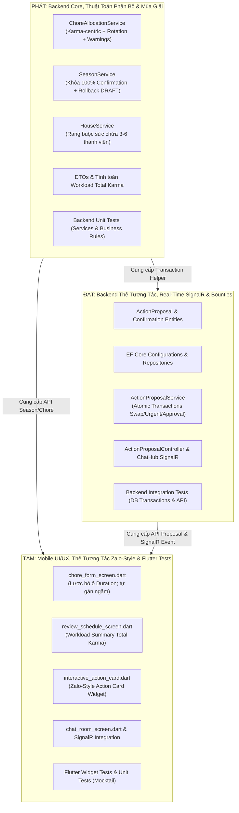
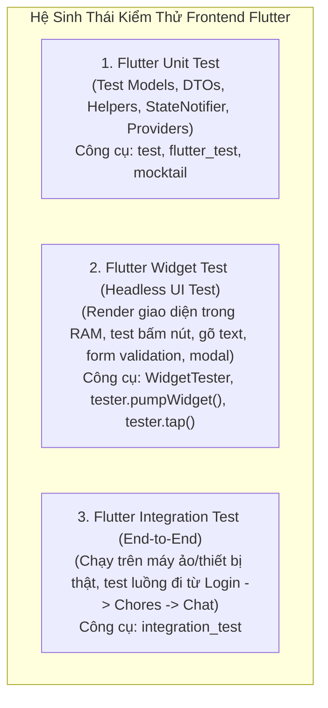

# KẾ HOẠCH KỸ THUẬT & KIỂM THỬ TOÀN BỘ HỆ THỐNG (BACKEND & FRONTEND — KHÔNG DÙNG AI)
## Phân Công 3 Developer: PHÁT, ĐẠT, TÂM
### Hướng Dẫn Test Flutter, Luồng Click-by-Click & Toàn Bộ Ma Trận Test

## 1. Goal Description

Bản kế hoạch này cung cấp giải pháp kỹ thuật toàn diện, khép kín cho toàn bộ hệ thống **Chore Wars** trên 2 nền tảng:
- **Backend**: .NET 10 (C#) Clean Architecture (Domain $\rightarrow$ Application $\rightarrow$ Infrastructure $\rightarrow$ Presentation).
- **Frontend**: Flutter 3 (Dart) Riverpod State Management & Feature-First Architecture.
- **TUYỆT ĐỐI KHÔNG DÙNG AI**: Tập trung 100% vào nghiệp vụ phần mềm, thuật toán phân bổ công bằng, cơ sở dữ liệu quan hệ, SignalR real-time và **Kế hoạch kiểm thử toàn diện (Master Testing Plan) cho cả Backend lẫn Frontend**.

Toàn bộ các thư mục test ở cả Backend và Frontend đã được khởi tạo sẵn kèm file `.gitkeep` để lưu vết trên Git:
- Backend: `backend/tests/UnitTests/Domain/`, `backend/tests/UnitTests/Services/`, `backend/tests/IntegrationTests/Controllers/`, `backend/tests/IntegrationTests/Repositories/`.
- Frontend: `mobile/test/features/chore/`, `mobile/test/features/chat/`, `mobile/test/features/house/`, `mobile/test/features/bounty/`, `mobile/test/widgets/`.

---

## 2. Phân Chia Vai Trò & Trách Nhiệm 3 Developer



---

## 3. Hướng Dẫn Toàn Diện Về Kiểm Thử Frontend (Dành Cho Tâm & Team)

> [!TIP]
> **Bên Backend dùng xUnit/Moq thì bên Frontend Flutter dùng gì?**
> Flutter có sẵn bộ công cụ kiểm thử cực mạnh tích hợp sâu trong SDK, chia làm 3 cấp độ:



### 3.1. So Sánh Chi Tiết Giữa Backend Test và Frontend Test

| Tiêu chí | Backend (.NET 10 - Phát & Đạt) | Frontend (Flutter - Tâm) |
|---|---|---|
| **Test Runner** | `dotnet test` (xUnit) | `flutter test` (`flutter_test` SDK) |
| **Thư viện Mock** | `Moq` | `mocktail` (Đã cài trong `pubspec.yaml`) |
| **Khẳng định kết quả (Assertions)** | `FluentAssertions` / `Assert.Equal` | `expect(actual, matcher)` |
| **Kiểm thử logic không có UI** | Service Unit Tests | Model & Provider Unit Tests |
| **Kiểm thử giao diện / bấm nút** | Controller Integration Tests | **Widget Tests (`WidgetTester`)** |
| **Môi trường chạy** | In-memory / Kestrel | In-memory Headless Engine (chạy siêu nhanh trong vài giây, không cần mở Android/iOS Emulator) |

### 3.2. Cách viết Widget Test trên Flutter (Ví dụ trực quan cho Tâm)

Trong Flutter, bạn không cần mở app trên điện thoại để test bấm nút. `WidgetTester` dựng widget ngay trong RAM:

```dart
// Ví dụ: Test form tạo chore không còn ô "Duration" và bấm nút Lưu thành công
testWidgets('ChoreFormScreen submits without Duration field', (WidgetTester tester) async {
  // 1. Render màn hình vào bộ nhớ ảo
  await tester.pumpWidget(
    const ProviderScope(
      child: MaterialApp(home: ChoreFormScreen()),
    ),
  );

  // 2. Kiểm tra ô "Duration" KHÔNG ĐƯỢC TỒN TẠI
  expect(find.text('Duration'), findsNothing);

  // 3. Giả lập người dùng nhập Tên việc và Karma
  await tester.enterText(find.byType(TextFormField).first, 'Rửa chén');
  await tester.enterText(find.widgetWithText(TextFormField, 'Karma'), '20');

  // 4. Giả lập người dùng bấm nút [Tạo việc]
  await tester.tap(find.text('Tạo việc'));
  await tester.pumpAndSettle(); // Đợi animation và xử lý bất đồng bộ hoàn tất

  // 5. Kiểm tra kết quả (ví dụ xuất hiện SnackBar thông báo thành công)
  expect(find.text('Tạo việc nhà thành công!'), findsOneWidget);
});
```

---

## 4. Luồng Tương Tác Giao Diện Chi Tiết (Click-by-Click UX Flows)

Mục này mô tả chính xác hành trình của người dùng trên toàn bộ các tính năng:

---

### LUỒNG 1: Tạo / Sửa Việc Nhà Thường Ngày (Lược bỏ ô Duration)
```
[Chore List Screen] 
       │
       ▼ (Bấm FloatingActionButton [+])
[ChoreFormScreen]
       │
       ├─► Nhập Tên: "Rửa bát"
       ├─► Nhập Mô tả: "Rửa sạch chén bát và úp khô"
       ├─► Chọn Loại: [Normal] / [Bonus]
       ├─► Nhập Karma: "20"
       ├─► Chọn Độ khó: Dropdown [EASY] / [MEDIUM] / [HARD]
       │   (ĐÃ XÓA HOÀN TOÀN Ô "Duration (min)")
       ├─► Chọn Tần suất: Dropdown [Hàng ngày / Hàng tuần...]
       │
       ▼ (Bấm nút [Tạo việc])
[Gửi API POST /api/v1/houses/{id}/chores]
       │
       ├─► Backend (Phát) tự động gán ngầm: EstimatedMinutes = Difficulty == EASY ? 15 : (MEDIUM ? 30 : 45)
       │
       ▼ (Nhận phản hồi 201 Created)
[Pop quay lại Chore List Screen]
       └─► Hiển thị SnackBar xanh: "Tạo việc nhà thành công!"
```

---

### LUỒNG 2: Đổi Việc Nhà Qua Thẻ Chat Tương Tác (Chore Swap Card)
```
[Lịch cá nhân của User A]
       │
       ▼ (Bấm vào thẻ việc "Rửa bát - Tối nay")
[Modal Chi tiết việc]
       │
       ▼ (Bấm nút [🔄 Đổi việc với thành viên khác])
[Dialog Chọn Đề Xuất Đổi Việc]
       │
       ├─► Dropdown chọn Thành viên đổi: "User B"
       ├─► Dropdown chọn Việc của B: "Quét nhà - Sáng mai"
       ├─► Nhập Ghi chú: "Tối nay bận làm đồ án"
       │
       ▼ (Bấm [Gửi Đề Xuất Đổi Việc])
[POST /api/v1/houses/{id}/proposals (Type: CHORE_SWAP)]
       │
       ├─► SignalR (Đạt) gửi Thẻ Tương Tác vào Chat Room của nhà
       ├─► B nhận Push Notification: "🔔 A vừa gửi yêu cầu đổi việc nhà cho bạn"
       │
[User B mở Tab Chat phòng]
       │
       ▼ (Thấy Thẻ Tương Tác Zalo-Style do Tâm dựng)
┌─────────────────────────────────────────────────────────────┐
│ 🔄 YÊU CẦU ĐỔI VIỆC NHÀ                                     │
│ A muốn đổi [Rửa bát - Tối nay] lấy [Quét nhà - Sáng mai]   │
│ Trạng thái: ⏳ Chờ B xác nhận                               │
│ [  ĐỒNG Ý  ]                   [  TỪ CHỐI  ]                │
└─────────────────────────────────────────────────────────────┘
       │
       ├─► Nếu B bấm [ĐỒNG Ý]:
       │     - API POST /api/v1/proposals/{id}/respond (CONFIRMED)
       │     - Backend (Đạt) hoán đổi UserId của 2 Occurrence trong 1 Transaction an toàn
       │     - SignalR broadcast: Thẻ chuyển màu xanh ✅ "Đã đổi việc thành công!"
       │     - Lịch của A và B lập tức tráo đổi cho nhau mà không cần reload
       │
       └─► Nếu B bấm [TỪ CHỐI]:
             - API POST /api/v1/proposals/{id}/respond (REJECTED kèm lý do)
             - Thẻ chuyển sang màu xám ❌ "B đã từ chối: [Lý do]"
             - Việc của ai giữ nguyên người đó
```

---

### LUỒNG 3: Việc Khẩn Cấp Chọn Lọc Thành Viên (Urgent Group Event Blitz)
```
[Màn hình Dashboard hoặc Chat]
       │
       ▼ (User A bấm [⚡ Nhiệm vụ khẩn cấp / Dọn tiệc])
[Modal Phát Động Nhiệm Vụ Khẩn Cấp]
       │
       ├─► Nhập Tiêu đề: "Dọn dẹp chuẩn bị tiệc sinh nhật"
       ├─► Tích chọn thành viên: [x] B, [x] C (D không tham gia -> bỏ trống)
       ├─► Thời hạn: 30 phút
       ├─► Danh sách việc nhỏ: (1) Lau bàn; (2) Hút bụi; (3) Rửa ly chén
       │
       ▼ (Bấm [Phát động chiến dịch])
[Gửi API POST /api/v1/houses/{id}/proposals (Type: URGENT_EVENT, Targets: [B, C])]
       │
       ├─► SignalR gửi Thẻ Tương Tác vào Chat phòng
       │
[Phân quyền trên Thẻ Chat]
       ├─► Với B và C: Hiển thị 2 nút [ Tham gia ngay ] / [ Bận rồi ]
       └─► Với D: Hiển thị Read-only ("Nhiệm vụ dành riêng cho A, B, C")
       │
       ▼ (Khi CẢ B VÀ C ĐỀU BẤM [Tham gia ngay] -> Đủ 100%)
[Backend (Đạt) thi hành tự động]
       ├─► Sinh 3 ChoreOccurrence khẩn cấp với Deadline = Now + 30 phút
       ├─► Proposal chuyển thành APPROVED
       ├─► Thẻ Chat cập nhật: "🎉 CHIẾN DỊCH KÍCH HOẠT! 30 PHÚT BẮT ĐẦU!"
       └─► Màn hình Dashboard và Chat ghim BANNER ĐỒNG HỒ ĐẾM NGƯỢC 30:00
```

---

### LUỒNG 4: Phê Duyệt Mùa Giải Mới (100% Confirmation Lock Flow)
```
[Chủ nhà tạo Mùa giải mới] 
       │
       ▼ (Chọn Xếp việc Tự động hoặc Thủ công)
[Màn hình ReviewScheduleScreen (Tâm refactor)]
       │
       ├─► BẢNG WORKLOAD SUMMARY LUÔN HIỂN THỊ Ở ĐẦU (cả Manual & Auto):
       │     - Avatar từng người
       │     - Tổng số việc
       │     - TỔNG ĐIỂM KARMA (Total Karma Balance do Phát tính)
       │     - Chỉ số chênh lệch công bằng (Fairness Score)
       │
       ▼ (Chủ nhà bấm [Gửi Phê Duyệt Mùa Giải])
[POST /api/v1/seasons/{id}/submit-review]
       │
       ├─► Season: DRAFT ──► REVIEWING
       ├─► SignalR gửi Thẻ Phê Duyệt vào Chat: "📋 Kế hoạch Mùa Giải Mới (Tiến độ: 1/3)"
       │
       ▼ (Từng thành viên xem lịch và biểu quyết)
       ├─► Tình huống 1: Mới có 1 hoặc 2 người bấm Xác nhận
       │     - Season VẪN LÀ REVIEWING (Chưa kích hoạt!)
       │     - Tiến độ trên Thẻ Chat cập nhật lên 2/3
       │
       ├─► Tình huống 2: Người thứ 3 bấm Xác nhận -> ĐỦ 100% CONFIRMED
       │     - Backend (Phát) kiểm tra allConfirmations.All(c => c.Status == CONFIRMED)
       │     - Season.Status = ACTIVE!
       │     - Thẻ Chat chúc mừng: "🎉 100% ĐỒNG THUẬN - MÙA GIẢI CHÍNH THỨC BẮT ĐẦU!"
       │
       └─► Tình huống 3: Có 1 người bấm [Yêu cầu sửa lại]
             - Season lập tức ROLLBACK VỀ DRAFT!
             - Thẻ Chat cảnh báo: "⚠️ Lịch đã bị từ chối, chuyển về Bản Nháp để Chủ nhà chỉnh sửa"
```

---

## 5. MA TRẬN KIỂM THỬ TOÀN BỘ HỆ THỐNG (MASTER TEST MATRIX)

| STT | Luồng Nghiệp Vụ (Flow) | Backend Test (.NET 10 xUnit) | Frontend Test (Flutter Widget/Unit) | Người Phụ Trách |
|---|---|---|---|---|
| **1** | **Xác thực & Gia nhập Nhà** (Auth & House) | - `HouseCapacityTests`: Chặn thành viên thứ 7 (`ConflictException`).<br/>- `HouseMemberRepositoryTests`: Đếm active members chính xác. | - `register_screen_test.dart`: Validate form đăng ký.<br/>- `join_house_screen_test.dart`: Hiển thị lỗi khi nhà đã đủ 6 người. | **Phát** (BE)<br/>**Tâm** (FE) |
| **2** | **Quản lý Việc Nhà Thường Ngày** (Chore Management) | - `CreateChoreRequestTests`: Tự động gán default 30m, mapping đúng từ `Difficulty`.<br/>- `ChoreRepositoryTests`: CRUD chore không bị null minutes. | - `chore_form_screen_test.dart`: **Xác nhận KHÔNG CÓ ô Duration**; submit tự suy luận số phút ngầm định. | **Phát** (BE)<br/>**Tâm** (FE) |
| **3** | **Phân Bổ & Vòng Đời Mùa Giải** (Season Lifecycle) | - `ChoreAllocationKarmaTests`: Cân bằng Total Karma lệch $\le 20\%$, phạt Xoay vòng việc (Chore Rotation), xuất Warnings.<br/>- `SeasonConfirmationLockTests`: Khóa 100% mới Active, Rollback Draft khi Reject. | - `review_schedule_karma_test.dart`: Bảng Workload Summary luôn hiện Total Karma cho cả Manual & Auto.<br/>- `season_status_badge_test.dart`: Hiển thị đúng badge DRAFT/REVIEWING/ACTIVE. | **Phát** (BE)<br/>**Tâm** (FE) |
| **4** | **Thẻ Tương Tác Xác Nhận Đa Thành Viên** (Action Proposals) | - `ActionProposalServiceTests`: Tạo proposal, phân quyền respond, hoán đổi việc nguyên tử (`CHORE_SWAP`), tạo việc khẩn cấp (`URGENT_EVENT`).<br/>- `ActionProposalControllerTests`: Test REST API 201 Created & 200 OK. | - `interactive_action_card_test.dart`: Hiển thị nút cho Target, ẩn nút cho non-target, loading spinner khi bấm.<br/>- `action_proposal_model_test.dart`: Parse JSON từ SignalR/API. | **Đạt** (BE)<br/>**Tâm** (FE) |
| **5** | **Real-Time WebSocket & Chat** (SignalR Messaging) | - `ChatHubProposalTests`: Broadcast event `ReceiveProposal` và `ProposalUpdated` vào đúng Room Group. | - `chat_signalr_service_test.dart`: Test subscribe event `ProposalUpdated` và cập nhật Riverpod StateNotifier. | **Đạt** (BE)<br/>**Tâm** (FE) |
| **6** | **Chợ Tiền Thưởng & Nợ Nần** (Bounties & Debts) | - `BountyServiceTests`: Đăng bounty tiền thật, nhận bounty, hết hạn phạt 120% forced compensation.<br/>- `PaymentObligationTests`: Settle nợ và ghi nhận PaidAt. | - `bounty_board_screen_test.dart`: Chuyển mượt 5 tabs (Available, Posted, Accepted, Debts, History), dialog Settle nợ. | **Đạt** (BE)<br/>**Tâm** (FE) |

---

## 6. CHECKLIST ĐẦU VIỆC CHI TIẾT CHO PHÁT, ĐẠT, TÂM

---

### 👨‍💻 DEVELOPER 1: PHÁT (Backend Core, Thuật Toán Phân Bổ & Season Life-Cycle)

#### 1. Code Implementation Checklists
- [ ] Mở `backend/src/Application/DTOs/Chore/CreateChoreRequest.cs`:
  - [ ] Đặt giá trị mặc định: `public int EstimatedMinutes { get; set; } = 30;`
  - [ ] Thêm static method `GetDefaultMinutes(ChoreEffort difficulty)`: Easy $\rightarrow$ 15, Medium $\rightarrow$ 30, Hard $\rightarrow$ 45.
- [ ] Mở `backend/src/Application/DTOs/Season/WorkloadSummaryResponse.cs`:
  - [ ] Bổ sung trường `public int TotalKarma { get; set; }` vào class `MemberWorkload`.
  - [ ] Bổ sung trường `public double KarmaVariancePercentage { get; set; }`.
- [ ] Mở `backend/src/Application/Services/ChoreAllocationService.cs`:
  - [ ] Refactor `AllocateSeasonAsync`:
    - [ ] Sắp xếp danh sách chore chưa gán theo `KarmaPoints` giảm dần, tiếp theo là `Difficulty` giảm dần.
    - [ ] Tạo bảng theo dõi `Dictionary<Guid, int> memberKarmaSum` để tích lũy Karma gán trong mùa.
    - [ ] Áp dụng **Chore Rotation Penalty**: Phạt $+50$ điểm cost nếu gán việc X cho người đã làm việc X ở tuần liền trước.
    - [ ] Ưu tiên chọn người rảnh lịch VÀ đang có `memberKarmaSum` thấp nhất để cân bằng Karma.
    - [ ] Bổ sung cảnh báo chi tiết vào `response.Warnings` khi vi phạm ràng buộc (thay vì gán ngầm).
  - [ ] Refactor `GetWorkloadSummaryAsync`:
    - [ ] Tính `TotalKarma = memberOccurrences.Sum(o => o.Chore.KarmaPoints)`.
- [ ] Mở `backend/src/Application/Services/SeasonService.cs`:
  - [ ] Refactor `ConfirmSeasonAsync`: Kiểm tra điều kiện `allConfirmations.All(c => c.Status == ConfirmationStatus.CONFIRMED)` mới cho chuyển sang `SeasonStatus.ACTIVE`. Nếu chưa đủ 100% thì giữ nguyên `REVIEWING`.
  - [ ] Refactor `RejectSeasonAsync`: Đổi confirmation của user thành `REJECTED`, đồng thời rollback `season.Status = SeasonStatus.DRAFT;`.
- [ ] Mở `backend/src/Application/Services/HouseService.cs`:
  - [ ] Trong `JoinHouseAsync`: Đếm số active members, nếu $\ge 6$ thì `throw new ConflictException("Nhà đã đạt giới hạn tối đa 6 người.");`.

#### 2. Test Implementation Checklists (xUnit & Moq)
- [ ] Tạo file `backend/tests/UnitTests/Services/ChoreAllocationKarmaTests.cs`:
  - [ ] Test 1: `AllocateSeasonAsync_ShouldBalanceKarma_AcrossAllMembers` (Độ lệch chuẩn Karma giữa các thành viên $\le 20\%$).
  - [ ] Test 2: `AllocateSeasonAsync_ShouldAvoidAssigningSameChore_InConsecutiveWeeks` (Kiểm tra quy tắc xoay vòng việc).
  - [ ] Test 3: `AllocateSeasonAsync_ShouldPopulateWarnings_WhenConstraintConflictsOccur`.
  - [ ] Test 4: `GetWorkloadSummaryAsync_ShouldReturnAccurateTotalKarma`.
- [ ] Tạo file `backend/tests/UnitTests/Services/SeasonConfirmationLockTests.cs`:
  - [ ] Test 1: `ConfirmSeasonAsync_WhenPartialConfirmed_ShouldStayReviewing`.
  - [ ] Test 2: `ConfirmSeasonAsync_WhenAllConfirmed_ShouldBecomeActive`.
  - [ ] Test 3: `RejectSeasonAsync_WhenOneRejects_ShouldRollbackToDraft`.
- [ ] Tạo file `backend/tests/UnitTests/Services/HouseCapacityTests.cs`:
  - [ ] Test 1: `JoinHouseAsync_When6ActiveMembers_ShouldThrowConflictException`.
  - [ ] Test 2: `JoinHouseAsync_WhenUnder6ActiveMembers_ShouldAddMemberSuccessfully`.

---

### 👨‍💻 DEVELOPER 2: ĐẠT (Backend Thẻ Tương Tác, Real-Time SignalR & Bounties)

#### 1. Code Implementation Checklists
- [ ] Tạo Domain Enums:
  - [ ] `backend/src/Domain/Enums/ProposalType.cs` (`CHORE_SWAP = 0`, `URGENT_EVENT = 1`, `SEASON_APPROVAL = 2`).
  - [ ] `backend/src/Domain/Enums/ProposalStatus.cs` (`PENDING = 0`, `APPROVED = 1`, `REJECTED = 2`, `CANCELLED = 3`).
- [ ] Tạo Domain Entities:
  - [ ] `backend/src/Domain/Entities/ActionProposal.cs` (`Id`, `HouseId`, `RoomId`, `CreatorId`, `Type`, `Status`, `Title`, `Description`, `PayloadJson`, `CreatedAt`, `ExpiresAt`).
  - [ ] `backend/src/Domain/Entities/ProposalConfirmation.cs` (`Id`, `ProposalId`, `TargetUserId`, `Status`, `Reason`, `RespondedAt`).
- [ ] Cấu hình EF Core:
  - [ ] `backend/src/Infrastructure/Data/Configurations/ActionProposalConfiguration.cs` (Quan hệ 1-N, Index trên HouseId & RoomId).
  - [ ] `backend/src/Infrastructure/Data/Configurations/ProposalConfirmationConfiguration.cs`.
  - [ ] Đăng ký DbSet vào `backend/src/Infrastructure/Data/AppDbContext.cs`.
- [ ] Tạo Repository:
  - [ ] `backend/src/Application/Interfaces/Repositories/IActionProposalRepository.cs`.
  - [ ] `backend/src/Infrastructure/Repositories/ActionProposalRepository.cs`.
- [ ] DTOs & Service:
  - [ ] `backend/src/Application/DTOs/Proposal/ActionProposalDTOs.cs` (`CreateProposalRequest`, `RespondProposalRequest`, `ActionProposalResponse`).
  - [ ] `backend/src/Application/Interfaces/Services/IActionProposalService.cs`.
  - [ ] `backend/src/Application/Services/ActionProposalService.cs`:
    - [ ] `CreateProposalAsync`: Validate, tạo proposal + confirmations, commit transaction.
    - [ ] `RespondProposalAsync`: Validate target user, đổi trạng thái. Nếu Reject $\rightarrow$ Proposal REJECTED. Nếu 100% Confirm $\rightarrow$ Thực thi hoán đổi `UserId` của 2 occurrences trong 1 transaction an toàn, hoặc tạo việc khẩn cấp.
- [ ] Presentation:
  - [ ] `backend/src/Presentation/Controllers/ActionProposalController.cs` (`POST /houses/{id}/proposals`, `POST /proposals/{id}/respond`, `GET /rooms/{id}/proposals/active`).
  - [ ] `backend/src/Presentation/Hubs/ChatHub.cs`: Thêm methods broadcast `ReceiveProposal` và `ProposalUpdated` tới group room.

#### 2. Test Implementation Checklists (xUnit, Moq, Integration)
- [ ] Tạo file `backend/tests/UnitTests/Services/ActionProposalServiceTests.cs`:
  - [ ] Test 1: `CreateProposalAsync_ShouldCreatePendingConfirmationsForTargets`.
  - [ ] Test 2: `RespondProposalAsync_WhenTargetRejects_ShouldMarkProposalRejected`.
  - [ ] Test 3: `RespondProposalAsync_WhenAllTargetsConfirm_ShouldSwapChoreAssigneesAtomically` (Kiểm tra tráo đổi đúng `UserId`).
  - [ ] Test 4: `RespondProposalAsync_WhenNonTargetResponds_ShouldThrowForbiddenException`.
- [ ] Tạo file `backend/tests/IntegrationTests/Controllers/ActionProposalControllerTests.cs`:
  - [ ] Test 1: `POST /api/v1/houses/{id}/proposals` trả về `201 Created`.
  - [ ] Test 2: `POST /api/v1/proposals/{id}/respond` trả về `200 OK` với dữ liệu cập nhật.
- [ ] Tạo file `backend/tests/UnitTests/Services/BountyCompensationTests.cs`:
  - [ ] Test 1: Kiểm tra Bounty hết hạn kích hoạt bồi thường 120% (`ForcedCompensationAmount`).
  - [ ] Test 2: Kiểm tra Settle nợ cập nhật đúng trạng thái và `PaidAt`.

---

### 👨‍💻 DEVELOPER 3: TÂM (Mobile UI/UX, Thẻ Tương Tác Zalo-Style & Flutter Tests)

#### 1. Code Implementation Checklists
- [ ] Đã thêm `mocktail: ^1.0.4` vào `mobile/pubspec.yaml`.
- [ ] Tinh giản Form Tạo Việc ([chore_form_screen.dart](file:///d:/FPT/Semester_8/PRM393/project/chore-wars/mobile/lib/features/chore/presentation/screens/chore_form_screen.dart)):
  - [ ] Xóa bỏ biến `_estimatedMinutes`, xóa hàm dispose của nó.
  - [ ] Xóa bỏ toàn bộ widget `TextFormField` nhập Duration.
  - [ ] Chỉnh Dropdown Độ khó (`Difficulty`) trải rộng toàn hàng (`Expanded`).
  - [ ] Trong `_submit()`: Tự động tính `estimatedMinutes = _difficulty == ChoreEffort.easy ? 15 : (_difficulty == ChoreEffort.medium ? 30 : 45)`.
- [ ] Cập nhật Màn hình Review Schedule ([review_schedule_screen.dart](file:///d:/FPT/Semester_8/PRM393/project/chore-wars/mobile/lib/features/house/presentation/screens/review_schedule_screen.dart)):
  - [ ] Xóa bỏ điều kiện `if (!isManual)` bao bọc Workload Summary.
  - [ ] Hiển thị thanh tiến độ Total Karma của từng thành viên kèm số lượng việc.
- [ ] Xây dựng Thẻ Tương Tác Zalo-Style trong Chat:
  - [ ] Tạo Model `mobile/lib/features/chat/data/models/action_proposal_model.dart`.
  - [ ] Tạo Service `mobile/lib/features/chat/data/services/action_proposal_service.dart`.
  - [ ] Tạo Provider `mobile/lib/features/chat/providers/action_proposal_providers.dart` (`StateNotifierProvider`).
  - [ ] Tạo Widget `mobile/lib/features/chat/presentation/widgets/interactive_action_card.dart`:
    - [ ] Icon bo tròn theo loại (🔄 Đổi việc, ⚡ Khẩn cấp, 📋 Duyệt mùa).
    - [ ] Tiêu đề, mô tả, danh sách avatar kèm icon trạng thái (⏳ Chờ, ✅ Đồng ý, ❌ Từ chối).
    - [ ] Action buttons `[ Đồng ý ]` và `[ Từ chối ]` chỉ hiện cho Target User chưa duyệt.
    - [ ] Trạng thái khi hoàn tất: Đổi nền xanh ngọc nhẹ kèm icon checkmark.
- [ ] Nhúng vào [chat_room_screen.dart](file:///d:/FPT/Semester_8/PRM393/project/chore-wars/mobile/lib/features/chat/presentation/screens/chat_room_screen.dart):
  - [ ] Render các `InteractiveActionCard` trong luồng chat.
  - [ ] Kết nối `chat_signalr_service.dart` để nhận event `ProposalUpdated` và cập nhật tức thì.

#### 2. Test Implementation Checklists (Flutter Unit & Widget Tests)
- [ ] Tạo file `mobile/test/features/chore/chore_form_screen_test.dart` (Widget Test):
  - [ ] Test 1: `testWidgets('Verify ChoreFormScreen does NOT contain Duration field')`:
    - Dùng `tester.pumpWidget(...)`.
    - Kiểm tra `expect(find.text('Duration'), findsNothing)`.
  - [ ] Test 2: `testWidgets('Verify form submission infers correct minutes from difficulty')`:
    - Nhập Tên việc, Karma 20, chọn Medium.
    - Bấm nút Lưu $\rightarrow$ Kiểm tra hàm submit nhận `estimatedMinutes = 30`.
- [ ] Tạo file `mobile/test/features/chat/interactive_action_card_test.dart` (Widget Test):
  - [ ] Test 1: `testWidgets('InteractiveActionCard displays action buttons for target user')`:
    - Render card với proposal nhắm vào current user.
    - Xác nhận tìm thấy `find.text('Đồng ý')` và `find.text('Từ chối')`.
  - [ ] Test 2: `testWidgets('InteractiveActionCard hides action buttons for non-target user')`:
    - Render card với proposal nhắm vào user khác.
    - Xác nhận các nút hành động bị ẩn hoặc disable.
  - [ ] Test 3: `testWidgets('Tapping Confirm triggers respondProposal API call')`:
    - Dùng `tester.tap(find.text('Đồng ý'))` $\rightarrow$ Xác nhận provider gọi hàm respond.
- [ ] Tạo file `mobile/test/features/house/review_schedule_karma_test.dart` (Widget Test):
  - [ ] Test 1: `testWidgets('ReviewScheduleScreen renders Total Karma summary for manual allocation')`:
    - Render màn hình với `isManual = true`.
    - Xác nhận tìm thấy nhãn `Total Karma` và thanh phân bổ của từng thành viên.
- [ ] Tạo file `mobile/test/features/chat/action_proposal_model_test.dart` (Unit Test):
  - [ ] Test 1: Parse JSON từ Backend thành `ActionProposalModel` đầy đủ các trường và danh sách confirmations.

---

## 7. HƯỚNG DẪN LỆNH CHẠY TEST CHO TOÀN BỘ HỆ THỐNG

### Chạy Kiểm Thử Backend (.NET 10 - Phát & Đạt):
```powershell
# 1. Biên dịch Backend
dotnet build backend/src/Presentation/Presentation.csproj

# 2. Chạy toàn bộ Unit Tests của Phát & Đạt (Chi tiết từng test case)
dotnet test backend/tests/UnitTests/UnitTests.csproj --logger "console;verbosity=detailed"

# 3. Chạy Integration Tests cho Proposals & Controller của Đạt
dotnet test backend/tests/IntegrationTests/IntegrationTests.csproj
```

### Chạy Kiểm Thử Frontend (Flutter - Tâm):
```powershell
cd mobile

# 1. Kiểm tra phân tích tĩnh mã nguồn (Bắt buộc: 0 errors, 0 warnings)
flutter analyze

# 2. Chạy riêng từng bài Widget Test của Tâm
flutter test test/features/chore/chore_form_screen_test.dart
flutter test test/features/chat/interactive_action_card_test.dart
flutter test test/features/house/review_schedule_karma_test.dart

# 3. Chạy TOÀN BỘ bài test của ứng dụng Mobile
flutter test --reporter expanded
```
