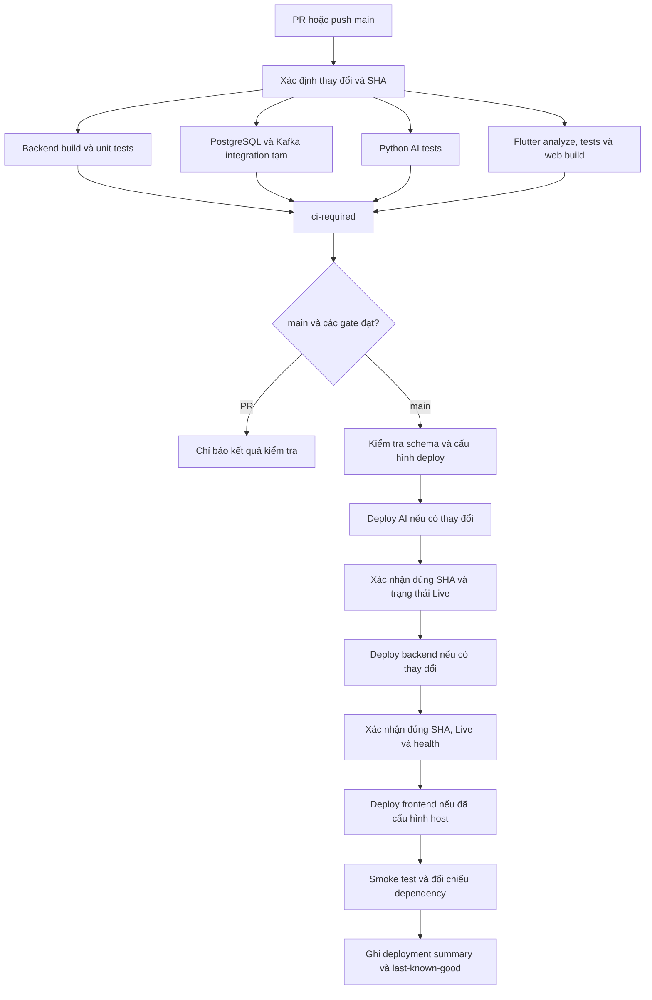

# Kế hoạch CI/CD GitHub Actions → Render

Ngày tạo: 27/10/2026. Cập nhật: 28/10/2026. Baseline source: `6de0b92`.
Trạng thái: đã triển khai workflow, scripts và health/schema checks trong source. Chưa kích hoạt CD production vì còn thiếu GitHub environment secrets/protection và cấu hình Render. Hướng dẫn thực thi: [CI/CD runbook](../../scripts/ci/README.md).

“Deploy đạt” trong tài liệu này nghĩa là: đúng commit đã test, schema phù hợp,
dịch vụ bắt buộc hoạt động, smoke test đạt và có bằng chứng. Chữ Live của Render
hoặc một request health 200 đơn lẻ chưa đủ để kết luận cả hệ thống đã sẵn sàng.

## 0. Cách xây dựng theo thứ tự

1. Tạo `.github/workflows/ci-cd.yml`: chạy check trên PR và main, chưa bật job deploy ngay.
2. Dựng PostgreSQL/Kafka tạm cho runner, pin SDK, chạy tests/build và kiểm tra kết quả skip.
3. Đưa deploy hooks/API key vào GitHub environment secrets; service ID/health URL vào variables.
4. Hoàn thiện health/schema/version/dependency checks và các bài test khi DB thiếu bảng, Kafka hỏng, sai SHA.
5. Hoàn tất database AI và những thành phần cần có theo inventory; ghi rõ profile core/full.
6. Bật job deploy sau `ci-required`: schema gate → AI → backend → frontend khi đã có host FE.
7. Poll tới đúng SHA Live, readiness ổn định và smoke đạt; sau đó mới đánh dấu phát hành thành công.
8. Chốt rollback, required checks và báo cáo; thử một PR lỗi, một PR đạt, một bản deploy lỗi và bài test tắt Docker local.

Các bước trên là việc sẽ triển khai, không phải hệ thống CI/CD đang chạy.

## 1. Kết quả cần đạt

- Mở hoặc cập nhật PR vào `main`: tự chạy các kiểm tra có liên quan, không deploy production.
- Merge/push vào `main`: kiểm tra lại chính commit đó; chỉ deploy khi các kiểm tra bắt buộc đạt.
- Backend và AI trên Render chạy đúng SHA đã được kiểm tra, không lấy commit mới hơn chưa test.
- Workflow phân biệt Render đã nhận yêu cầu, đang build, đã Live và thất bại.
- Test không dùng PostgreSQL, Kafka, Redis, Gemini hoặc payOS production.
- Migration database có quy trình riêng; không xóa DB, reset volume hoặc tự chạy migration lúc backend khởi động.
- Người dùng không cần mở máy local hoặc nhờ bot AI chạy lệnh mỗi lần deploy.

## 2. Hiện trạng đã đối chiếu source

| Thành phần | Hiện trạng | Hệ quả cho CI/CD |
| --- | --- | --- |
| GitHub | Repo `ottise/chore-wars`, nhánh `main`, chưa có `.github/workflows` | Tạo pipeline mới |
| Backend | .NET 10; local SDK 10.0.302; solution `backend/ChoreWars.slnx` | Build/test cùng SDK được pin |
| AI | Python 3.12; `requirements.lock`, `pyproject.toml`, Alembic | Cài từ lock; test schema với PostgreSQL tạm |
| Mobile/web | Flutter local 3.47.2 stable, Dart 3.13.2, `pubspec.lock` | Pin Flutter, không tự nâng SDK mỗi lần build |
| Render backend | Service ID `srv-dbg5812jnfac73fag7r0`; URL `https://chore-wars-o3rm.onrender.com` | Có thể cấu hình ID dưới dạng GitHub variable |
| Render AI API | URL `https://chorewars-ai.onrender.com`; chưa có service ID trong tài liệu | Lấy ID từ Dashboard khi cấu hình |
| Cách nối source | Đang nhập URL Public Git Repository | Chọn Deploy Hook, không phụ thuộc auto-deploy của Git Provider |
| Kafka | Backend/Python worker đã hỗ trợ SASL/TLS | Test broker local; credential Aiven chỉ nằm trên Render |
| Database chính cloud | Đã chuyển 55 bảng, 27 migration từ Docker; đối chiếu checksum trước commit; health backend 200 | Giữ dữ liệu, áp dụng schema gate cho thay đổi tiếp theo; không restore lại mỗi lần deploy |
| Database AI cloud | Chưa tồn tại `chorewars_ai` tại lần kiểm tra gần nhất | Chưa đạt điều kiện phát hành đầy đủ AI |
| Frontend | Source mặc định gọi backend Render; người dùng còn chạy Flutter local | FE local vẫn phải chạy; cần thêm host frontend nếu muốn độc lập máy local |
| Media cloud | Đã có metadata trong DB, chưa chuyển file ảnh/voice | Không coi kiểm tra DB là bằng chứng media đã hoạt động |
| Health hiện tại | Backend kiểm tra kết nối DB; AI thực hiện `select 1` | Chưa đủ kết luận bảng đã tồn tại hoặc Gemini trả lời được |
| AI nền | API, worker, trainer là các tiến trình khác nhau | Deploy API không tự deploy worker/trainer |

Những test đã chạy ở baseline là bằng chứng local, không phải bằng chứng GitHub Actions đã chạy.

## 3. Kiến trúc và thứ tự chạy



Ưu tiên AI trước backend khi cả hai cùng đổi contract. Nếu AI fail thì không tiếp tục backend.
Nếu chỉ backend đổi thì bỏ qua bước AI. Đây không phải giao dịch deploy nguyên tử:
API/contract phải tương thích trong khoảng hai phiên bản chạy xen kẽ.

## 4. Triggers, gate và phạm vi thay đổi

Workflow chính `ci-cd.yml` dùng `pull_request` vào `main`, `push` vào `main`, và `workflow_dispatch`.
Dispatch chỉ cho deploy SHA đã thuộc `main` và phải chạy đủ kiểm tra cho SHA đó.
Không dùng `pull_request_target` để checkout/chạy code PR có quyền production.

| Path thay đổi | Kiểm tra bắt buộc | Deploy |
| --- | --- | --- |
| `backend/**` | Backend unit, integration, Docker build | Backend |
| `ai-service/**` | Python unit/runtime, Docker build, backend-AI contract khi contract đổi | AI API |
| `mobile/**` | Flutter analyze/test/web build | Đợt đầu tạo artifact; khi đã có host FE, deploy FE sau backend |
| Backend DTO/client AI hoặc Python schema | Cả backend và AI; contract test giữa hai tiến trình | Theo source tương ứng |
| `.github/**`, `scripts/ci/**`, `docker-compose.ci.yml`, version pins | Toàn bộ kiểm tra bị ảnh hưởng; không mặc định bỏ qua | Theo job tính change scope |
| Chỉ tài liệu | Kiểm tra cấu trúc workflow nếu có; không build lại dịch vụ | Không deploy |
| Migration, EF snapshot, Alembic migration | Kiểm tra DB sạch, upgrade, schema gate | Chặn CD nếu migration chưa được áp dụng theo quy trình mục 8 |

Job `ci-required` luôn có kết quả, kể cả PR chỉ tài liệu. Job này kiểm tra kết quả của
các job thực sự bắt buộc theo change scope; không báo đạt khi job cần thiết fail hoặc bị hủy.
Không dùng path filter ở cấp workflow khiến required check không xuất hiện.

## 5. Các job kiểm tra

### Backend

- Restore và build solution, bao gồm `WorkerTestHost`; cùng cấu hình build/test để harness tìm đúng DLL.
- Chạy unit tests, xuất TRX.
- Chạy integration trên PostgreSQL/Kafka riêng của runner.
- Kiểm tra EF model không có thay đổi chưa được migration ghi nhận.
- Build Docker context `backend` để kiểm tra đúng đường dẫn COPY, restore và publish Release.
- Không cache thư mục chứa cấu hình local hoặc dữ liệu private.

### Database và Kafka tạm cho CI

`docker-compose.ci.yml` chỉ có PostgreSQL và Kafka KRaft phục vụ kiểm tra.
PostgreSQL bind `127.0.0.1`, Kafka có listener host `localhost:9094` và listener nội bộ phù hợp.
Chỉ dùng tài khoản/mật khẩu test không có giá trị bên ngoài runner.

Backend fixture chỉ chấp nhận PostgreSQL `localhost` hoặc `127.0.0.1`, tạo database
`cw_test_*` riêng rồi xóa chính DB test sau kiểm tra. Python dùng `cw_ai_test_*` tương tự.
Không truyền các connection string Render vào CI test.

Biến bắt buộc cho nhóm runtime tests:

| Nhóm | Biến môi trường |
| --- | --- |
| Backend PostgreSQL | `CHOREWARS_TEST_POSTGRES` |
| Backend Kafka | `CHOREWARS_TEST_KAFKA`, `CHOREWARS_TEST_KAFKA_CONTAINER` |
| Python PostgreSQL | `AI_TEST_POSTGRES_ADMIN` |
| Python Kafka | `AI_TEST_KAFKA` |
| Contract với Python API | `CHOREWARS_TEST_AI_URL`, `CHOREWARS_TEST_AI_KEY` của tiến trình test local |

- Chờ health/metadata bằng polling có timeout; không chỉ sleep cố định.
- Test pause/unpause broker được chạy tuần tự, trên container riêng đúng tên.
- Thu log container khi fail, dọn compose CI với `always()`; không gọi compose production.
- TRX/JUnit được kiểm tra số skipped. Nhóm test bắt buộc bị skip do quên env phải làm job fail.
- Ba test backend cần Python API thật: khởi chạy API fixture local và test provider có phản hồi cố định,
  chỉ trong test harness. Không giả lập kết quả thành công của production và không dùng khóa Gemini thật trên PR.
- Kiểm tra provider Gemini thật tách khỏi required CI, chạy thủ công khi cần; không gọi payOS thật trong CI.

### Python AI

- Cài Python 3.12 và dependencies từ `requirements.lock`, sau đó package project cùng test dependencies.
- Chạy pytest toàn bộ; cấp PostgreSQL/Kafka local để các runtime tests có thể chạy thực sự.
- Kiểm tra Alembic upgrade trên database test mới và không có schema diff ngoài migration.
- Xuất JUnit và log worker test.
- Build Docker context `ai-service`.

### Flutter

- Pin Flutter 3.47.2 ở lượt triển khai đầu, xác minh phiên bản có thể cài trên runner; thiếu SDK phải báo lỗi.
- `flutter pub get`, `flutter analyze lib test`, `flutter test`.
- `flutter build web --release` với cùng các dart-define dự kiến khi host frontend.
- Upload web artifact; chưa tự phát hành frontend tới một dịch vụ chưa tồn tại.
- Rà `mobile/Dockerfile` đang clone rồi upgrade Flutter mỗi build; thay bằng bản pin tương ứng khi triển khai.

### Thời gian và cache

- PR cũ được hủy khi PR có commit mới; mỗi job có timeout khoảng 15–30 phút theo loại test/build.
- Cache NuGet, pip và Pub bằng khóa gồm OS, SDK và hash lockfile; không cache `.env`, DB, certificate hay media.
- Retention artifact ban đầu 7 ngày; log thất bại và test report vẫn upload nếu job fail.
- Không cache cả workspace hoặc thư mục home.

## 6. Deploy backend/AI lên Render

### Cấu hình GitHub một lần

Tạo GitHub environment `production`, giới hạn branch `main`.
Không đặt required reviewer cho deploy code thông thường nếu mục tiêu là tự deploy sau test.

| Loại | Tên | Nơi lấy / mục đích |
| --- | --- | --- |
| Secret | `RENDER_BACKEND_DEPLOY_HOOK` | Render backend > Settings > Deploy Hook |
| Secret | `RENDER_AI_DEPLOY_HOOK` | Render AI > Settings > Deploy Hook |
| Secret | `RENDER_API_KEY` | Dùng kiểm tra deploy ID/trạng thái/SHA bằng API chính thức; tài khoản có quyền tối thiểu cần thiết |
| Secret | `DEPLOYMENT_HEALTH_KEY` | Khóa chỉ đọc cho endpoint health chi tiết; cùng giá trị `DeploymentHealth__Key` trên backend Render, không dùng lại AI key |
| Variable | `RENDER_BACKEND_SERVICE_ID` | `srv-dbg5812jnfac73fag7r0` |
| Variable | `RENDER_AI_SERVICE_ID` | Lấy service ID thật từ Dashboard |
| Variable | `BACKEND_HEALTH_URL` | `https://chore-wars-o3rm.onrender.com/health/ready` |
| Variable | `AI_HEALTH_URL` | `https://chorewars-ai.onrender.com/health/ready` |

Đợt đầu chủ repo nhập các secret trực tiếp trên GitHub. Không gửi vào chat hoặc commit chúng.
Gemini, PostgreSQL production, payOS và mật khẩu/CA Aiven vẫn ở Render; không cần chuyển chúng vào CI thông thường.

### Cách trigger và xác nhận

1. Job CD chỉ chạy trên `main` với các required job thành công và schema gate đạt.
2. Kiểm tra SHA chưa bị commit mới thay thế trước khi trigger. Commit cũ bị superseded được ghi rõ, không coi là đã deploy.
3. POST Deploy Hook, truyền `ref=<SHA đã test>`. Xử lý query string bằng thư viện URL, không nối sai dấu `?`/`&`.
4. HTTP 200 chỉ là đã nhận yêu cầu; lấy deploy ID và poll Render API tới `live` hoặc trạng thái fail/cancel.
5. HTTP 202 nghĩa đang xếp hàng, có thể không có deploy ID. Poll danh sách deploy của service,
   đối chiếu commit SHA; không đánh dấu thành công chỉ vì health của bản cũ trả 200.
6. Xác nhận deploy Live có commit đúng SHA, rồi kiểm tra health có timeout và retry cho cold start.
7. Ghi service, SHA, deploy ID và kết quả vào GitHub Summary. Không in hook URL hay Authorization header.
8. Khi HTTP 429, backoff theo header nếu có; không gọi API liên tục. Poll khoảng 15 giây, tổng thời hạn khoảng 20 phút.

CD dùng concurrency group theo production, không hủy lượt đang phát hành dở chỉ vì có commit mới.
CI có thể hủy lượt cũ, CD xử lý tuần tự và kiểm tra superseded ở đầu mỗi lượt.
Không bật song song auto-deploy trực tiếp Render và deploy hook nếu sẽ phát hành trùng.
Không tùy ý retry POST khi timeout chưa biết Render đã nhận chưa; tìm deploy theo SHA trước.

## 7. Readiness và giới hạn kiểm tra production

### 7.1. Ba lớp kiểm tra riêng

| Lớp | Endpoint/tín hiệu dự kiến | Điều kiện đạt | Khi không đạt |
| --- | --- | --- | --- |
| Liveness | `/health/live` | Process trả lời; không gọi DB/Kafka/Gemini | Xem crash/OOM/process/port; Render xử lý instance theo chính sách nền tảng |
| Readiness backend | `/health/ready` | Đọc được DB, migration history phù hợp, bảng nghiệp vụ bắt buộc tồn tại | HTTP 503, không đưa bản mới vào phục vụ |
| Readiness AI API | `/health/ready` | Đúng database AI, schema Alembic đầy đủ, cấu hình service key/model hợp lệ | HTTP 503; không coi Uvicorn khởi động là AI ready |
| Dependency/release gate | Endpoint được bảo vệ hoặc kiểm tra vận hành có xác thực | Trạng thái thực của Kafka, cache, AI, worker và media theo release profile | CD fail/degraded rõ ràng; không biến thành restart loop cho toàn bộ app |
| Version | `/health/version` dự kiến + Render API | SHA của phiên bản Live đúng SHA đã test | Dừng xác nhận deploy; health của bản cũ không được tính |

Public health chỉ trả status tối thiểu; không trả hostname private, SQL, exception,
connection string, thông tin tài khoản hoặc secret. Báo cáo chi tiết dành cho log vận hành
và endpoint được bảo vệ bằng quyền riêng của deployment, không tái dùng khóa AI cho mọi quyền.

Readiness không chạy migration, không tạo user/đơn hàng, không gọi Gemini tính phí,
không gửi notification và không chuyển tiền. Tổng thời gian response mục tiêu dưới 3 giây,
để còn khoảng trống so với hạn 5 giây của HTTP health check Render.
Các probe mạng chậm chạy nền với timeout/cache kết quả ngắn; HTTP probe không mở đồng thời
hàng loạt kết nối broker mỗi vài giây. Liveness không phụ thuộc kết quả các probe này.

Pipeline yêu cầu HTTP 200 từ endpoint đã quy định; không theo redirect tới trang login
rồi coi đó là health đạt. Render chấp nhận 2xx/3xx trong HTTP health check, nhưng CD dùng
điều kiện chặt hơn và kiểm tra body/status theo contract.

### 7.2. Ma trận kiểm tra dependency

| Thành phần | Kiểm tra cần làm | Ý nghĩa |
| --- | --- | --- |
| Core DB | Kết nối, đúng database, EF history, bảng Users/RefreshTokens/Houses/AIChatInsights và manifest migration | Ngăn trường hợp `select 1` đạt nhưng login 500 do thiếu bảng |
| AI DB | Database AI tồn tại, Alembic revision tương thích và bảng cần cho API | Ngăn AI chỉ Live nhưng không truy vấn được dữ liệu |
| JWT/config | Đủ signing key hợp lệ, issuer/audience nhất quán; không in giá trị | Ngăn login lỗi khi tạo token dù DB đúng |
| Kafka | Metadata qua SASL/TLS, certificate/hostname hợp lệ, topic cần thiết có thật, quyền tương ứng, outbox/consumer quan sát được | Phân biệt không kết nối, sai port, sai password, sai CA, thiếu topic hoặc consumer không chạy |
| Redis | Ping có timeout; chế độ cache fallback vẫn hoạt động | Cache lỗi có thể là degraded; không tự tuyên bố mất cache làm hỏng dữ liệu chính |
| AI API | Core gọi health/contract với đúng service authentication khi cần; kiểm tra configured và reachable riêng | `AI__Enabled=true` không chứng minh AI đang trả lời |
| Gemini | Key/model được khai báo; lần kiểm tra provider thật tách riêng có quyền và budget | `provider_configured=true` chỉ là có key; không bằng chứng key hợp lệ hoặc còn quota |
| AI worker | Process/service thực sự deploy, heartbeat gần đây; kiểm tra consumer group/lag có phân biệt đang idle | Không có event mới thì lag bằng 0 chưa chứng minh worker sống |
| Trainer | Kiểm tra theo chế độ daemon/scheduled đã chọn, thời điểm lần chạy và deadline tương ứng | Không ép job theo lịch phải phát heartbeat như daemon |
| Ảnh/voice | Storage bền vững đã cấu hình, file đã chuyển, quyền truy cập đúng nhà, file canary đọc được | Có MediaAttachment trong DB không có nghĩa file tồn tại |
| Frontend | HTML/assets load, route login, API/hub URL cloud, CORS/HTTPS/WebSocket | Không gọi localhost hoặc hostname Docker `backend` từ môi trường cloud |

Backend vẫn có thể phục vụ thao tác cốt lõi trong khi cache hoặc broker đang degraded
nhờ cache fallback/outbox. CD báo rõ thiếu năng lực tương ứng và chặn chứng nhận release đầy đủ,
không trộn “core đang dùng được” với “toàn bộ hệ thống đạt”.
Canary Kafka dùng topic/group riêng, không đưa sự kiện giả vào topic nghiệp vụ production.
Canary cần quyền riêng; nếu chưa được cấu hình thì kết quả là unverified, không ghi PASS.
Việc tạo canary topic/file hoặc dùng tài khoản smoke sẽ được chốt khi triển khai, không phát sinh tự ý trong lượt lập kế hoạch.

### 7.3. Smoke test sau khi đúng SHA đã Live

1. Poll readiness tới 3 lần thành công liên tiếp, cách nhau 10 giây, trong timeout đã định.
2. Đối chiếu deploy ID/SHA qua Render API và version metadata.
3. Kiểm tra route API có thật; endpoint cần auth trả 401 khi không có token, không trả 500/HTML gateway error.
4. Kiểm tra FE tải được và trỏ đúng API/SignalR; nếu dùng proxy thì kiểm tra cả proxy, không chỉ URL backend trực tiếp.
5. Kiểm tra schema/dependency report và ghi rõ degraded/unverified.
6. Kiểm thử login hai tài khoản, chat, notification, upload và voice trước hết trên staging có dữ liệu test.
   Production mặc định chỉ smoke đọc-only; tài khoản test, việc tạo session và lưu token cần được cho phép riêng,
   token chỉ ở bộ nhớ của job, không xuất artifact/log.
7. Giao dịch payOS thật không thuộc smoke test tự động; không mua hàng hoặc gửi SMS để xác nhận deploy.

Không dùng mật khẩu cá nhân thật trong YAML/test fixture, không tự đăng nhập tài khoản người dùng.
Không lấy việc kiểm tra response 401 thay thế cho nghiệm thu đăng nhập thành công.

### 7.4. Theo dõi sau phát hành

- Giữ một cửa sổ quan sát ban đầu khoảng 5 phút, có thể cấu hình theo gói/cold start.
- Theo dõi readiness, HTTP 5xx, latency, restart/OOM, backlog/oldest pending outbox và consumer lag.
- Không có quyền metrics/logs thì ghi rõ giới hạn quan sát, không ghi các số 0 giả.
- Chỉ thực hiện probe đọc-only và có backoff; không dùng lịch ping để cố giữ Free service luôn thức.
- GitHub Summary là báo cáo của lần phát hành, không phải monitor 24/7. Theo dõi lâu dài cần
  Render alerts hoặc monitor riêng được cấu hình sau, không tự tạo automation trong cuộc trò chuyện.

Nếu chỉ có hook mà chưa có quyền API theo dõi, kết quả là “đã yêu cầu deploy, chưa xác minh”.
Trạng thái này chưa đạt tiêu chí CD hoàn chỉnh.

## 8. Migration database

Lỗi thiếu bảng core trước đó đã được xử lý bằng bản chuyển database có sự cho phép của người dùng:
55 bảng và 27 migration đã được kiểm tra checksum trước commit; DB Docker gốc được giữ nguyên.
Đây là bootstrap một lần, không phải bước CI/CD được lặp lại trên mỗi push.
Database `chorewars_ai` và storage ảnh/voice vẫn chưa hoàn tất ở lần kiểm tra gần nhất.

Đợt triển khai đầu:

1. Kiểm tra lại read-only migration history trên DB cloud được chỉ định sau khi có quyền truy cập; không giả định trạng thái cũ vẫn giữ nguyên.
2. Tạo bản backup và SQL/migration artifact để review; xác định có giữ dữ liệu local để import hay không.
3. Chủ DB cho phép việc áp dụng migration production; không coi việc chốt kế hoạch CI/CD là cho phép thay đổi DB.
4. Chạy migration .NET cho DB nghiệp vụ và Alembic cho DB AI bằng quy trình riêng phù hợp.
5. Xác minh history/schema và health; chỉ sau đó bật deploy tự động.

Workflow `db-migrate.yml` được thiết kế là manual (`workflow_dispatch`), dùng environment
`production-db` có required reviewer, kiểm tra SHA thuộc `main`, artifact/hash migration và database đích.
Credential migration không được chia sẻ cho job build/test/deploy hook.
Nếu gói GitHub không hỗ trợ required reviewers theo visibility của repo, giữ migration thủ công,
không thay bằng một nút dispatch không bảo vệ.

Schema gate CD đọc migration history, không sửa schema. Credential kiểm tra có quyền đọc tối thiểu,
tách khỏi credential migration. Trong tương lai dùng các secret môi trường `SCHEMA_CORE_CONNECTION`
và `SCHEMA_AI_DATABASE_URL` của tài khoản read-only; chỉ job gate tin cậy trên `main` được truy cập.
Nếu chưa có kết nối schema gate, CD fail với hướng dẫn cấu hình, không bỏ qua kiểm tra.

Khi code mới có migration chưa được áp dụng: CI vẫn test trên DB tạm, CD dừng ở schema gate.
Chạy workflow migration có phê duyệt, rồi chạy lại CI/CD đúng SHA.
Sử dụng thay đổi schema kiểu mở rộng trước, thu hẹp sau để bản code cũ vẫn chạy được trong lúc deploy.
Không tự chạy Down migration hoặc hoàn tác dữ liệu khi deploy code fail.

Docker Command AI hiện người dùng đã được hướng dẫn chạy `python -m app.cli migrate` trước Uvicorn.
Khi chuyển sang mô hình migration có gate, cần đưa migration ra workflow/quy trình riêng và đổi lệnh AI
về chỉ Uvicorn trong cùng đợt vận hành; nếu giữ startup migration thì không thể tuyên bố DB chỉ đổi sau approval.

## 9. File tạo mới và file sửa

Danh sách dưới là phạm vi dự kiến; file source đã có sẽ được sửa tại chỗ.
Chưa triển khai workflow hoặc thay đổi health source trong lượt lập kế hoạch này.

Chi tiết từng file, input/output, caller/callee, cách kiểm tra và thứ tự thực hiện:
[phụ lục manifest file CI/CD](github-actions-render-cicd-file-manifest.vi.md).
Phụ lục là bản chi tiết cho bảng tóm tắt dưới đây, bao gồm cả DTO/authorization/options
phải đi kèm endpoint health và cấu hình ngoài repository.

| File | Thay đổi / trách nhiệm |
| --- | --- |
| `.github/workflows/ci-cd.yml` | PR/main triggers, change scope, test jobs, required gate và CD tuần tự |
| `.github/workflows/db-migrate.yml` | Migration manual có approval, SHA/artifact/hash và bước xác minh |
| `.github/dependabot.yml` | Đề xuất cập nhật GitHub Actions/dependencies phù hợp lockfile, không auto-merge thay đổi SDK |
| `docker-compose.ci.yml` | PostgreSQL/Kafka tạm, listener host/container, health, không volume production |
| `scripts/ci/check_results.py` | Đọc TRX/JUnit, chặn fail hoặc required test bị skip |
| `scripts/ci/render_deploy.py` | Trigger hook theo SHA, theo dõi API, retry/backoff, output không lộ secret |
| `scripts/ci/schema_gate.py` | Chỉ đọc lịch sử migration cloud, đối chiếu manifest đúng SHA |
| `scripts/ci/smoke_test.py` | Kiểm tra đúng SHA, health ổn định, route/auth boundary và proxy; không dùng tài khoản thật |
| `scripts/ci/check_release.py` | Đối chiếu inventory và profile, xuất bảng pass/fail/degraded/unverified |
| `deploy/services.json` | Inventory service, owner, URL/service ID, required/optional và cấu hình health không chứa secret |
| `scripts/ci/migration_manifest.py` | Sinh danh sách EF/Alembic migration, checksum và metadata artifact |
| `scripts/ci/migrate_database.sh` | Quy trình migration đã được approve, không dùng từ workflow CI/PR |
| `scripts/ci/README.md` | Hướng dẫn chạy các script bằng fixture local |
| `scripts/ci/tests/test_render_deploy.py` | Test 200/202/401/429/fail/timeout/sai SHA; mock HTTP, không trigger Render thật |
| `scripts/ci/tests/test_schema_gate.py` | Test DB chưa có bảng, migration thiếu, sai DB, đúng revision; không sửa production |
| `scripts/ci/tests/test_smoke_test.py` | Test health của bản cũ, redirect, cold start, 503, timeout, thiếu dependency và sai FE origin |
| `global.json` | Pin SDK .NET thống nhất với baseline |
| `.config/dotnet-tools.json` | Pin `dotnet-ef` tương thích .NET/EF của repo |
| `backend/src/Application/Interfaces/Services/IDatabaseSchemaStatus.cs` | Contract kiểm tra schema đọc-only, không chứa EF/HTTP |
| `backend/src/Infrastructure/Data/DatabaseSchemaStatus.cs` | Đọc pending migration/table readiness bằng EF/Npgsql |
| `backend/src/Presentation/Health/DatabaseReadinessCheck.cs` | Gọi schema status; 503 khi chưa sẵn sàng, không trả chi tiết credential |
| `backend/src/Presentation/Controllers/DeploymentHealthController.cs` | Health chi tiết có authorization, version metadata; public route không lộ chi tiết nội bộ |
| `backend/src/Presentation/Extensions/InfrastructureServiceExtensions.cs` | Đăng ký schema status qua DI |
| `backend/tests/IntegrationTests/Infrastructure/DatabaseReadinessTests.cs` | DB kết nối được nhưng thiếu bảng phải chưa ready |
| `backend/tests/IntegrationTests/Infrastructure/AIServiceContractTests.cs` và test harness | Cho chạy contract local không cần secret production/Gemini live |
| `ai-service/app/main.py` | Readiness kiểm tra migration/schema của AI |
| `ai-service/tests/test_readiness.py` | Phân biệt kết nối thành công, schema thiếu, schema ready |
| `mobile/Dockerfile` | Pin Flutter, bỏ upgrade không xác định |
| `mobile/scripts/build-render-web.sh` | Cùng build flags giữa CI và host FE; trỏ API/hub cloud, không dùng proxy Docker local |
| `mobile/nginx.conf` hoặc template proxy được chọn | Chỉ sửa nếu host FE bằng container; upstream cloud/HTTPS/SNI/WebSocket phải đúng, không hardcode Docker host |
| `docs/testing/github-actions-render-cicd.vi.md` | Runbook secret/variable, activate, rerun, deploy rollback và migration |
| `docs/plans/README.md` | Link kế hoạch, cập nhật trạng thái sau triển khai |

Nếu file đã tồn tại ở thời điểm triển khai thì sửa tại chỗ, không tạo lớp/script trùng chức năng.
Script migration chỉ được triển khai/kích hoạt sau khi chủ DB chốt cách approval và backup.

## 10. Luồng đi qua file

```text
PR/main
  → .github/workflows/ci-cd.yml
  → docker-compose.ci.yml + source/tests backend, ai-service, mobile
  → scripts/ci/check_results.py
  → ci-required
  → scripts/ci/migration_manifest.py + scripts/ci/schema_gate.py (chỉ trên main)
  → scripts/ci/render_deploy.py
  → Render Deploy Hook(ref=SHA) → Dockerfile service → service Live
  → Render API xác nhận SHA + /health/ready
  → GitHub Summary/test artifacts

Migration cần áp dụng
  → .github/workflows/db-migrate.yml (manual, protected environment)
  → xác nhận backup + manifest/SHA/DB đích
  → scripts/ci/migrate_database.sh
  → EF/Alembic migration đã được review
  → schema gate đọc-only
  → rerun ci-cd.yml cùng SHA
```

Các bước production không chạy trên PR hoặc code từ fork. Không đưa tên PR/branch
không tin cậy trực tiếp vào shell; truyền qua biến môi trường/tham số có kiểm tra.

## 11. Trình tự triển khai

1. **CI trước:** pin SDK, tạo fixture CI, test reports và required check. Chạy thử PR fail/pass.
2. **Đóng khoảng trống test:** bật PostgreSQL/Kafka runtime tests, contract local và skip detection.
3. **Docker và artifact:** build đúng context; xác nhận không copy key/media riêng; web artifact.
4. **Chuẩn bị Render:** lấy service IDs, hook, API key, health URLs; tạo GitHub environments/secrets.
5. **Schema ban đầu:** core đã chuyển; kiểm tra lại schema, hoàn tất database AI bằng quy trình có backup và cho phép riêng.
6. **CD thử thủ công:** workflow dispatch chính SHA main đã test, theo dõi AI rồi backend tới Live.
7. **Bật CD trên main:** bỏ trigger deploy trùng, thử hai commit liên tiếp và xử lý superseded/queue.
8. **Bảo vệ main:** yêu cầu PR và `ci-required` nếu chủ repo đồng ý; không cho bot tự merge PR.
9. **Nghiệm thu:** ghi SHA, deploy ID, test count/skip, URL health và kịch bản rollback.

Không hứa thời gian deploy cố định: Free Render có cold start và build/queue phụ thuộc tài nguyên.
Không tạo dịch vụ trả phí mới hoặc thay đổi gói tài khoản để triển khai kế hoạch này.

## 12. Tiêu chí nghiệm thu

- PR lỗi test không được merge qua required check và không trigger hook.
- PR từ fork không đọc được secret deploy/migration.
- Merge main đạt test dẫn tới đúng SHA Live trên service có thay đổi.
- Deploy thiếu secret, sai hook, 202 queue, 429 hoặc build fail không báo thành công giả.
- Health 200 từ bản cũ không làm deploy commit mới được coi là thành công.
- Backend-AI deploy tuần tự, không deploy backend nếu AI bắt buộc vừa fail.
- EF/Alembic missing migration khiến CD dừng; workflow CI không sửa DB production.
- Schema đã đúng thì lần sửa code thông thường có thể tự deploy, không yêu cầu approval lặp lại.
- Replay event không tạo thông báo/nợ trùng; consumer không đọc nhầm nhà qua runtime tests.
- Có log/test artifact đủ chẩn đoán nhưng không có hook, password, API key, private media.
- Có thể deploy lại SHA code tốt trước đó bằng thao tác manual; không tự rollback DB.
- Tắt Docker trên máy người phát triển, mở FE đã host trên một máy/mạng khác và kiểm tra các chức năng thuộc profile đã công bố.
- Profile full chỉ đạt khi FE, AI API/DB, worker và file storage đã được kiểm chứng; không chỉ dựa vào backend health 200.

## 13. Những việc chưa nằm trong đợt đầu

- Bot AI review/sửa code hoặc tự merge PR.
- Host frontend mới, Android release signing/Play Store.
- Tự deploy trainer/worker khi chưa có service tương ứng và storage phù hợp.
- Đổi broker, nhà cung cấp database, mở database công khai hoặc đồng bộ dữ liệu hai chiều.
- Giao dịch payOS thật, chuyển tiền, SMS hoặc nhắn thông báo thử tới người dùng production.
- Tự nâng AutoMapper qua major version: cảnh báo hiện tại cần việc xử lý dependency riêng và hồi quy.

## 14. Nguồn tham khảo chính thức

- Render deploys: https://render.com/docs/deploys
- Deploy Hook và tham số ref: https://render.com/docs/deploy-hooks
- Kiểm tra deploy ID: https://api-docs.render.com/reference/retrieve-deploy
- GitHub workflow security: https://docs.github.com/en/actions/reference/security/secure-use
- GitHub environments/approval: https://docs.github.com/en/actions/how-tos/deploy/configure-and-manage-deployments/manage-environments
- Cache và giới hạn dữ liệu nhạy cảm: https://docs.github.com/en/actions/reference/workflows-and-actions/dependency-caching
- HTTP health checks và điều kiện sẵn sàng: https://render.com/docs/health-checks
- Rollback và phạm vi config được dùng lại: https://render.com/docs/rollbacks

## 15. Checklist “deploy đạt” và các gate bắt buộc

### Gate A — Trước merge

- [ ] Required checks xuất hiện trên mọi PR; không mất check do path filter.
- [ ] SDK/action/image được pin; package lấy đúng lockfile, không upgrade ngầm lúc build.
- [ ] Build, unit, PostgreSQL/Kafka integration, contract và Flutter test cần thiết đạt.
- [ ] Required runtime tests không bị skip do thiếu biến môi trường.
- [ ] Schema model khớp migration; migration đã được thử với DB sạch và bản dữ liệu test nâng cấp.
- [ ] Không có secret thật trong source, image build context, cache hoặc artifact.
- [ ] Quét dependency/image: lỗ hổng mới mức high/critical phải được sửa hoặc được chấp nhận có owner/lý do/hạn xử lý.
- [ ] Cảnh báo AutoMapper đang có được ghi thành việc theo dõi có hạn xử lý, không xóa cảnh báo để tạo kết quả xanh giả.
- [ ] Không có dữ liệu mock được bật trong bản production.

### Gate B — Trước trigger production

- [ ] SHA thuộc main, đã đạt CI, chưa bị lượt mới thay thế.
- [ ] Inventory xác định đầy đủ service cần deploy và dependency required/optional.
- [ ] Hook, service ID, quyền API, config URL/PORT, JWT, SSL/SASL và secret file đã được kiểm tra hiện diện mà không in giá trị.
- [ ] Schema gate đọc-only đạt; nếu có migration pending thì dừng để xử lý workflow riêng.
- [ ] Có backup phù hợp trước thay đổi schema; không chạy restore DB Docker như một deploy step thường xuyên.
- [ ] Có SHA/deploy ID tốt gần nhất cho từng service; không ghi nhận một bản chỉ được trigger là last-known-good.
- [ ] Không có hai cơ chế cùng auto deploy một commit, không build từ HEAD trôi khác SHA đã test.

### Gate C — Sau deploy

- [ ] Render trả deploy ID; trường hợp queue 202 được theo dõi và đối chiếu rõ ràng.
- [ ] Đúng commit SHA đạt trạng thái Live trong thời hạn; sai SHA hoặc timeout làm job fail.
- [ ] Readiness trả 200 ổn định; không redirect, không response HTML hoặc health từ phiên bản cũ.
- [ ] Schema/bảng nghiệp vụ đủ; test boundary không trả 500 do thiếu bảng.
- [ ] Kafka metadata/topic/consumer được kiểm tra; cache degraded được báo rõ theo chính sách đã chốt.
- [ ] Frontend và API/hub/asset cùng dùng URL cloud đúng; CORS và WebSocket được kiểm tra theo môi trường thực.
- [ ] File media canary đọc được từ storage cloud khi profile yêu cầu media.
- [ ] Không có crash loop, OOM hoặc dependency outage mới trong cửa sổ quan sát.
- [ ] Summary ghi SHA, service, deploy ID, thời điểm, test count/skip và trạng thái từng dependency.
- [ ] Chỉ sau các bước trên mới cập nhật last-known-good cho release.

## 16. Xử lý lỗi và rollback

| Lỗi | Cách pipeline phản ứng |
| --- | --- |
| Unit/build/analyze lỗi | Dừng trước deploy; lưu test report và log đã che secret |
| Thiếu bảng / migration pending | Dừng schema gate; xác định đúng DB; không sửa bằng xóa DB hoặc thay connection string ngẫu nhiên |
| Kafka còn localhost | Báo cấu hình chưa áp dụng hoặc sai phiên bản; đối chiếu env name và SHA Live |
| SASL/CA/topic lỗi | Báo nhóm lỗi cụ thể trong log vận hành; không tự tắt TLS hoặc bật anonymous |
| Render hook 401/404 | Kiểm tra hook/service ID/ref; không retry vô hạn |
| Render 202 | Theo dõi queue và commit; không báo deploy thành công sớm |
| Render/API 429 | Backoff theo rate limit, có timeout tổng |
| Bản mới không qua health | Đánh dấu release fail; kiểm tra Render còn phục vụ bản trước; không tạo vòng redeploy liên tục |
| Live nhưng smoke fail | Dừng các service tiếp theo; lưu bằng chứng; xem xét rollback code đúng service bị ảnh hưởng |
| Chỉ Redis không đạt | Báo degraded theo khả năng cache fallback; không coi DB bị mất dữ liệu |
| Gemini hết quota | Báo AI/provider unavailable, giữ chức năng core; không restart toàn bộ backend để thử lại liên tục |
| Media mất sau redeploy | Chặn chứng nhận full; sửa lưu trữ bền vững, không coi việc metadata vẫn còn là đã phục hồi file |

Đợt đầu rollback code là manual có kiểm soát: chọn last-known-good SHA của service,
kiểm tra nó tương thích schema hiện tại, rồi dùng Render Deploy/Rollback phù hợp.
Nếu không còn artifact cũ trên gói đang dùng, rebuild/deploy đúng SHA đã ghi nhận.
Không cam kết rollback tức thì trên Free tier hoặc artifact không còn được lưu.

Rollback code không khôi phục toàn bộ trạng thái hệ thống. Render có thể dùng lại environment variables
và command của deploy đích trong lần rollback; environment groups có quy tắc khác và settings hiện tại
không bị ghi đè vĩnh viễn. Vì vậy cần kiểm tra secret đã rotate, command, health path và schema compatibility
trước khi rollback. Database, volume, dữ liệu và thao tác thanh toán không được hoàn tác cùng code.
Không tự chạy Down migration, restore backup hay gửi lại giao dịch khi phát hành lỗi.
Sau rollback phải xác minh lại Live/SHA/health/smoke và ghi kết quả, không chỉ kiểm tra nút rollback đã bấm.
Các thay đổi contract và migration dùng hướng expand/contract để giảm rủi ro rollback.

Nếu Render giữ bản cũ khi deploy mới fail, ghi rõ “bản mới thất bại, bản cũ còn phục vụ”,
không báo đã rollback thành công nếu chưa có thao tác/kiểm chứng tương ứng.

## 17. Inventory và nghiệm thu độc lập Docker local

| Thành phần | Điều kiện cloud cần hoàn tất | Tình trạng tại lần kiểm tra gần nhất |
| --- | --- | --- |
| Backend | Render service, đúng PORT/config/SHA, schema và health | Đã deploy, DB core đã chuyển |
| PostgreSQL core | Dữ liệu ở Render; backup và migration history đúng | 55 bảng, 27 migration; không phụ thuộc Docker local |
| Redis | Render Key Value; ping/fallback được kiểm chứng | Đã khai báo cấu hình, còn cần bằng chứng runtime |
| Kafka | Aiven broker, SASL/TLS/CA/topics/permissions và consumers | Đã tạo broker/config, còn cần nghiệm thu luồng thực |
| AI API | Render service, core gọi được đúng service key | Đã deploy API, chưa đủ bằng chứng full AI |
| PostgreSQL AI | Database AI tồn tại, schema Alembic và dữ liệu cần thiết | `chorewars_ai` chưa tồn tại ở lần kiểm tra gần nhất |
| AI worker/trainer | Service/job cloud và heartbeat/lịch chạy/đĩa artifact phù hợp | Chưa xác nhận deploy |
| Frontend | URL công khai, build config cloud, asset/router/proxy đúng | Còn chạy local; cần host FE riêng |
| File ảnh/voice | Chuyển file và dùng storage bền vững, giữ quyền truy cập | Mới chuyển metadata DB, chưa chuyển file |

`deploy/services.json` ghi profile rõ ràng: `core` và `full`. Việc đổi required thành optional
phải được review, không dùng để hợp thức hóa dependency đang hỏng.
Profile core không được báo là toàn bộ tính năng đã chạy cloud; profile full yêu cầu
các thành phần đang dùng trong sản phẩm đều được triển khai và kiểm chứng.

Frontend đề xuất host Render Static Site với build Flutter được pin, dùng URL API/SignalR cloud.
Chỉ sau khi chủ repo cấu hình service FE và xác nhận nơi host mới thêm hook/service ID của frontend.
Nếu vẫn dùng Docker/nginx thì phải thay upstream `http://backend:8080` bằng upstream cloud hợp lệ,
xử lý HTTPS/SNI và WebSocket; Docker service name local không tồn tại tự động trên Render.
Render Free không được coi là nơi lưu ảnh/voice bền vững trên filesystem mỗi instance;
phần media cần phương án lưu trữ được chốt riêng trước khi nghiệm thu full.

Đợt triển khai đủ inventory chạy bài nghiệm thu:

1. Tắt Docker trên máy người phát triển và dừng FE local.
2. Mở URL FE cloud bằng máy/trình duyệt khác, ưu tiên mạng khác.
3. Đăng nhập bằng hai tài khoản test đã được cho phép; kiểm tra đúng nhà/quyền.
4. Thử chat/notification realtime, ảnh, voice và AI theo profile; đây là nghiệm thu có dữ liệu test,
   không phải probe tự động vài giây một lần trên tài khoản thật.
5. Restart/redeploy service chứa media, đọc lại file để xác nhận bền vững.
6. Ghi pass/fail từng mục; lỗi hoặc mục chưa test vẫn phải được hiển thị trong báo cáo.

## 18. Thông tin chủ repo cần cung cấp khi bắt đầu triển khai

- Render Deploy Hooks và API key: nhập trực tiếp GitHub Secrets, không gửi trong chat.
- Service ID của AI; service ID/URL FE sau khi chọn host frontend.
- Quyền owner/admin repo để cấu hình required checks và GitHub environments.
- Cách tạo database AI, nơi lưu file ảnh/voice và nơi chạy worker/trainer; chốt chi phí trước khi tạo dịch vụ trả phí.
- Chính sách approval/backup cho migration tiếp theo; lần cho phép chuyển DB core vừa qua không phải cho phép mọi migration tương lai.
- Quyền dùng tài khoản/dữ liệu test nếu cần smoke có đăng nhập; mặc định production smoke không dùng mật khẩu cá nhân.

Đợt đầu triển khai CI và xuất báo cáo mà chưa có đủ secret/infra vẫn phải ghi trạng thái
“CI có, CD chưa cấu hình”, không ghi hệ thống đã auto deploy hoàn chỉnh.
